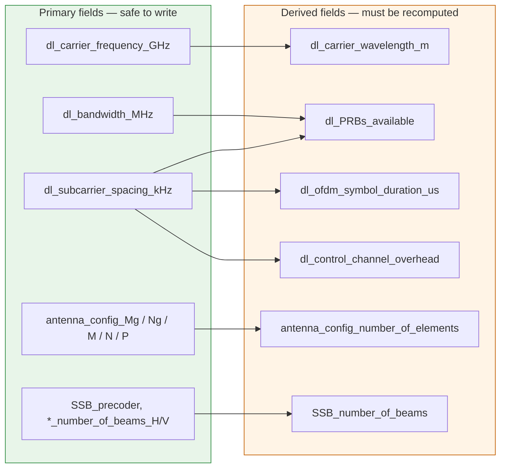
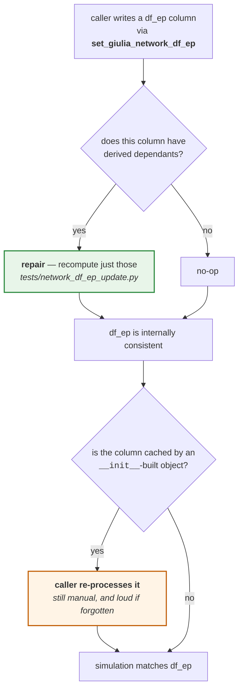

# Dedalo — `df_ep` consistency

`df_ep` is the table Dedalo exists to modify. This page describes what is in it, which of its
columns are **derived** from others, the machinery that checks and repairs them, and a
measured demonstration of what happens when a write skips that machinery.

The checks and repairs live under [`tests/`](../../tests/); `Dedalo` calls into them through a
handful of methods, and `set_giulia_network_df_ep` repairs derived columns by default, so the
common mistake is no longer reachable by accident. [§6](#6-what-dedalo-does-about-it)
describes that wiring and what it does not cover.

---

## 1. What `df_ep` is

The **DataFrame of Engineering Parameters**: one row per cell, one column per configurable
parameter. It is Giulia's single source of truth for network configuration, built by the
per-scenario constructors in [`giulia/bs/bs_deployments.py`](../../giulia/bs/bs_deployments.py)
and reachable as:

```python
df_ep = g.network_deployment_obj.df_ep      # cells — 57 × 96 on GiuliaStd / 3GPPTR38_901_5G
df_ep_ue = g.ue_deployment_obj.df_ep        # UEs  — 570 × 48   (only after g.configure())
```

Its columns group as follows:

| Group | What it fixes | Representative fields |
|---|---|---|
| Identity and hierarchy | Which cell this is, and the equipment that drives it | `ID`, `name`, `PCI`, `site_ID`, `radio_unit_ID`, `radio_unit_type`, `bbu_ID` |
| Role and pairing | Position in the RRM topology | `cell_role`, `paired_cell` |
| Position and mobility | Where the cell is | `position_x_m`, `position_y_m`, `position_z_m`, `indoor` |
| Radio access technology | Technology and frame structure | `RAT`, `fdd_tdd_ind`, `FR`, `subcarriers_per_PRB`, `ofdm_symbols_in_slot` |
| Carrier configuration | The DL/UL carriers and resource grid | `dl_carrier_frequency_GHz`, `dl_bandwidth_MHz`, `dl_PRBs_available`, `dl_subcarrier_spacing_kHz` |
| Transmission power | Transmit capability | `BS_tx_power_max_dBm`, `TX_number`, `RX_number`, `CRS_ports` |
| Antenna pattern | Element pattern and orientation | `antenna_config_max_gain_dBi`, `antenna_config_hor_alpha_mec_bearing_deg`, `antenna_config_ver_beta_elec_downtilt_deg` |
| Array geometry | Physical array structure | `antenna_config_Mg/Ng/M/N/P`, `antenna_config_number_of_elements`, `antenna_config_dh_m` |
| Beam configuration | SSB / CSI-RS codebooks | `SSB_precoder`, `SSB_number_of_beams`, `CSI_RS_precoder`, `CSI_RS_number_of_beams` |
| Propagation models | Per-cell channel models | `BS_propagation_model`, `BS_fast_channel_model` |
| Scheduling | MAC scheduling model | `BS_scheduling_model` |
| Energy features | Carrier-shutdown capability and state | `radio_enable_carrier_shutdown`, `radio_unit_initial_status` |

**Almost every interesting experiment is a write into this table**, which is why Dedalo's
generic surface is essentially "a validated way to write `df_ep`".

---

## 2. The problem: `df_ep` is not a flat set of knobs

Some columns are **functions of other columns**. The scenario constructor computes them once,
consistently. Nothing recomputes them afterwards.

So when Dedalo writes `dl_bandwidth_MHz`, the column `dl_PRBs_available` — which *should*
follow from bandwidth and subcarrier spacing — keeps its old value. The table is now
internally contradictory, and **nothing in Giulia notices**.



---

## 3. The measured cost of getting it wrong

Run on `GiuliaStd` / `3GPPTR38_901_5G`, one episode, one step. The action is a Dedalo write
halving every cell's downlink bandwidth:

```python
d.set_giulia_network_df_ep(d.get_cell_names(None), "dl_bandwidth_MHz", 50)
```

At 60 kHz subcarrier spacing, 100 MHz carries 135 PRB and 50 MHz carries 65 PRB. All four
combinations of *repair the derived field* × *re-process the carrier object*, measured:

| Repair derived? | Re-process? | `df_ep` PRBs | Mean UE throughput | Verdict |
|:---:|:---:|---:|---:|---|
| ✅ | ✅ | 65 | **84.363 Mbps** | correct |
| ✅ | ❌ | 65 | — | 💥 `RuntimeError: The size of tensor a (65) must match the size of tensor b (135)` |
| ❌ | ✅ | 135 | **175.457 Mbps** | ⚠️ silently wrong — **2.08×** |
| ❌ | ❌ | 135 | **175.457 Mbps** | ⚠️ silently wrong — **2.08×** |

Read the rows carefully, because the ranking is counter-intuitive:

- The **crash is the good outcome.** `df_ep` and the carrier object disagree about the array
  size, and PyTorch refuses. You find out immediately.
- The **bottom two rows are the bad outcome.** The run completes, produces a plausible
  number, and writes it to disk. The simulator is still using the 100 MHz resource grid while
  `df_ep` claims 50 MHz — a configuration that does not physically exist. An optimizer fed
  these rewards will converge on nonsense and give no indication anything is wrong.

A single unrepaired derived field moved a headline KPI by a factor of two, silently.

> **This is why `repair` defaults to `True`.** The two bottom rows are the ones the setter's
> default makes unreachable: the snippet above now lands on the **second** row — the loud
> crash — unless the caller also re-processes, in which case it lands on the first. Reaching a
> silently-wrong row requires explicitly asking for it with `repair=False`. See
> [§6](#6-what-dedalo-does-about-it).

---

## 4. Which object consumes what

Whether a write needs a re-process depends on who reads the field. Verified by tracing each
field through the source:

| Field written | Read by | Owning object | Rebuilt by `configure()`? | Action needed |
|---|---|---|:---:|---|
| `radio_unit_initial_status` | `bs/base_stations.py`, `bs/bs_tx_powers.py` | `base_stations_obj` | ✅ | none — free |
| `paired_cell` | `rrc/rrcs.py`, `bs/base_stations.py` | `base_stations_obj` (RRC layers) | ✅ | none — free |
| `carrier_shutdown_*_threshold` | `rrc/rrcs.py` | `base_stations_obj` | ✅ | none — free |
| `dl_bandwidth_MHz`, `dl_subcarrier_spacing_kHz` | `rrc/time_frequency_resources.py`, `kpis/calculate_noise.py` | `time_frequency_resource_obj` | ❌ | **repair `dl_PRBs_available` + re-process** |
| `dl_carrier_frequency_GHz` | `channel/carriers.py`, `rrc/time_frequency_resources.py` | `time_frequency_resource_obj` | ❌ | **repair `dl_carrier_wavelength_m` + re-process** |
| `antenna_config_M/N/Mg/Ng/P` | `antenna/antenna_arrays.py` | `cell_antenna_array_structure_obj` | ❌ | **repair `..._number_of_elements` + re-process** |
| `SSB_precoder`, `*_number_of_beams_H/V` | `rrc/beam_configs.py`, `kpis/power_consumptions.py` | `cell_SSB_conf_obj`, `power_consumption_obj` | ❌ | **re-process** (no updater exists — see §5) |
| `radio_unit_type`, `bbu_type` | `kpis/power_consumptions.py` | `power_consumption_obj` | ❌ | **re-process** |
| `position_*_m` | geometry chain | `distance_angles_*` | ✅ | none — free, but must precede `configure()` |

The ❌ rows are `__init__`-built objects that `configure()` never rebuilds. See
[The API contract § 5](./api.md#5-the-re-process-rule) for the chain and its ordering.

---

## 5. The machinery

Two modules under [`tests/`](../../tests/): `network_df_ep_check_list.py` reports drift and
`network_df_ep_update.py` repairs it. `Dedalo` does not reimplement any of it — it imports
these functions and wraps them in methods bound to its own `df_ep`.

### The checklist — [`tests/network_df_ep_check_list.py`](../../tests/network_df_ep_check_list.py)

Eleven checks, each recomputing a derived field from its sources and comparing:

| Check | Derived field | Recomputed from |
|---|---|---|
| [`_check_dl_carrier_wavelength_m`](../../tests/network_df_ep_check_list.py#L31) | `dl_carrier_wavelength_m` | `c / (f_GHz · 1e9)` |
| [`_check_ul_carrier_wavelength_m`](../../tests/network_df_ep_check_list.py#L53) | `ul_carrier_wavelength_m` | idem, uplink |
| [`_check_dl_PRBs_available`](../../tests/network_df_ep_check_list.py#L75) | `dl_PRBs_available` | `tools_carrier.bandwidth_to_PRBs(bw, scs)` |
| [`_check_dl_ofdm_symbol_duration_us`](../../tests/network_df_ep_check_list.py#L110) | `dl_ofdm_symbol_duration_us` | `tools_carrier.ofdm_symbol_duration(scs)` |
| [`_check_dl_control_channel_overhead`](../../tests/network_df_ep_check_list.py#L140) | `dl_control_channel_overhead` | `tools_carrier.control_channel_overhead(scs)` |
| [`_check_ul_available_PRBs`](../../tests/network_df_ep_check_list.py#L170) | `ul_available_PRBs` | idem, uplink |
| [`_check_ul_ofdm_symbol_duration_us`](../../tests/network_df_ep_check_list.py#L205) | `ul_ofdm_symbol_duration_us` | idem, uplink |
| [`_check_ul_control_channel_overhead`](../../tests/network_df_ep_check_list.py#L235) | `ul_control_channel_overhead` | idem, uplink |
| [`_check_antenna_config_number_of_elements`](../../tests/network_df_ep_check_list.py#L265) | `antenna_config_number_of_elements` | `Mg · Ng · M · N · P` (`single`→1, `dual`→2) |
| [`_check_SSB_number_of_beams`](../../tests/network_df_ep_check_list.py#L298) | `SSB_number_of_beams` | precoder-dependent; `custom_vMB` must match the direction-list lengths |
| [`_check_CSI_RS_number_of_beams`](../../tests/network_df_ep_check_list.py#L379) | `CSI_RS_number_of_beams` | idem, CSI-RS |

Each returns `(passed: bool, message: str)`; the message carries got-vs-expected. The drivers
are [`run_all_checklist`](../../tests/network_df_ep_check_list.py#L458),
[`print_checklist_results`](../../tests/network_df_ep_check_list.py#L494) (coloured terminal
report) and [`checklist_results_to_markdown`](../../tests/network_df_ep_check_list.py#L539).

Run it standalone — it builds its own Giulia and checks a pristine table:

```console
$ python tests/network_df_ep_check_list.py
────────────────────────────────────────────────────────────
  DataFrame Engineer Parameters Checklist Report
────────────────────────────────────────────────────────────
  Overall : PASS   (11/11 passed)

  Context
    preset: GiuliaStd
    scenario_model: 3GPPTR38_901_5G
    ue_distribution: uniform
    link_direction: downlink
```

### The updaters — [`tests/network_df_ep_update.py`](../../tests/network_df_ep_update.py)

Nine functions, each the repair for one check, taking and returning `df_ep`:

```python
from tests.network_df_ep_update import run_all_updates, run_selected_updates

df_ep = run_all_updates(df_ep)                                        # every repair
df_ep = run_selected_updates(df_ep, ["update_dl_PRBs_from_bandwidth_and_scs"])   # by name
df_ep = run_selected_updates(df_ep, [update_dl_PRBs_from_bandwidth_and_scs])     # or by ref
```

They are registered in [`ALL_UPDATE_FUNCTIONS`](../../tests/network_df_ep_update.py#L148) and
keyed by name in `UPDATE_FUNCTIONS_BY_NAME`, so a subset can be selected from a config string.

[`DERIVED_FIELD_UPDATERS`](../../tests/network_df_ep_update.py#L171) maps the *source* column
to the updaters a write to it invalidates — keyed by the column a caller passes, so a setter
can look up its own argument. [`repair_dependants_of`](../../tests/network_df_ep_update.py#L213)
runs exactly that set and nothing else:

```python
from tests.network_df_ep_update import updaters_for_field, repair_dependants_of

updaters_for_field("dl_bandwidth_MHz")   # [update_dl_PRBs_from_bandwidth_and_scs]
updaters_for_field("cell_role")          # []  — no derived dependants, nothing to do
df_ep = repair_dependants_of(df_ep, "dl_bandwidth_MHz")
```

Targeted repair matters: unlike `run_all_updates` it cannot mask a pre-existing inconsistency
in a column unrelated to the write. Every updater recomputes from current sources, so running
one twice is idempotent and running them in any order converges.

### The pattern to copy

`Dedalo_UnRL.set_BW_scs_prb_numerology` is the worked example of the full three-step sequence,
and the template for every non-trivial Dedalo setter:

```python
# 1. WRITE the primary fields through the validated accessor.
#    With repair=True (the default) step 2 already happened for each of these.
self.set_giulia_network_df_ep(cell_names_5G, "dl_bandwidth_MHz",          BW_MHz_5G)
self.set_giulia_network_df_ep(cell_names_5G, "dl_subcarrier_spacing_kHz", scs_kHz_5G)

# 2. REPAIR the derived fields (explicit belt-and-braces; idempotent)
self.giulia_obj.network_deployment_obj.df_ep = \
    update_dl_PRBs_from_bandwidth_and_scs(self.giulia_obj.network_deployment_obj.df_ep)

# 3. RE-PROCESS the cached objects that read them
self._update_giulia_object_static(skip_pairing=True)
```

Step 3 stays the caller's job. Dedalo repairs the *table*; it does not re-`process()` the
Giulia objects that cached it, because that is expensive and the right scope depends on what
the method as a whole changed — here, two columns at once.

---

## 6. What Dedalo does about it

The check/update machinery is *about* modifying `df_ep`, and Dedalo *is* the interface for
modifying `df_ep`. So Dedalo calls into it: the functions stay under `tests/`, where they are
also usable standalone, and `Dedalo` exposes them as methods bound to its own instance. The
point is not where the code sits — it is that the correct sequence is now the **default**
rather than something each caller has to remember.



The green step is what changed: it used to be the caller's job and was routinely skipped,
which is the silent failure in [§3](#3-the-measured-cost-of-getting-it-wrong). The orange step
is still the caller's job — deliberately, because its failure is loud.

Two things this does **not** change. The functions stay in `tests/` — `Dedalo` imports them,
it does not own them, and they remain runnable standalone against a pristine deployment. And
a direct `df_ep` assignment still bypasses all of it: writing
`df_ep['radio_unit_initial_status']` straight onto the frame gets none of these
guarantees. That is safe for *that* column — no dependants, and `configure()` rebuilds its
consumer — but it is outside the API.


### What the base class now offers

| Member | What it does |
|---|---|
| [`set_giulia_network_df_ep(..., repair=True)`](../../dedalo/dedalo.py#L73) | Write, then recompute the derived columns this write invalidated. |
| [`check_df_ep(verbose=False)`](../../dedalo/dedalo.py#L182) | Run the checklist against the bound instance; returns `{check: (passed, message)}`. |
| [`assert_df_ep_consistent()`](../../dedalo/dedalo.py#L198) | Raise `ValueError` naming the stale columns. Cheap enough for the top of `process_static`. |
| [`repair_df_ep(fields=None)`](../../dedalo/dedalo.py#L207) | Recompute every derived column, or a named subset. |

### Why `repair` defaults on

`repair` is cheap — pandas arithmetic over the cell rows — targeted at only the dependants of
the column just written, and idempotent, since every updater recomputes from current sources.
Its failure mode when omitted is the **silent** one. So it defaults on.

Re-processing the cached Giulia objects is the opposite on every count: expensive, broad, and
its failure mode when omitted is a **loud** crash. So Dedalo does not do it for you — the
caller re-processes what it changed, as `set_BW_scs_prb_numerology` does.

That `repair=True` is a no-op for existing callers is a measured claim, not an assumption:
every column written by `Dedalo_EE.process_static`, `Dedalo_UnRL.process_static` and the BO
and RL environments has no registered dependants, except the bandwidth/SCS pair in
`set_BW_scs_prb_numerology`, which already repaired them explicitly. The shutdown regression
in [Worked examples § 2](./examples.md#2-a-minimal-dedalo-from-scratch) reproduces to the
digit (24.428 kW, 122.523 Mbps) before and after the change.

### A latent bug the default already fixed

`set_BW_scs_prb_numerology` repaired `dl_PRBs_available` explicitly, but `dl_ofdm_symbol_duration_us`
and `dl_control_channel_overhead` *also* derive from the subcarrier spacing, and it never
repaired those. Changing the SCS therefore left the symbol duration at its previous value.

Measured on `3GPPTR38_901_4G_5G_multilayer`, making the call
`VLC_HAPS_RL_main.py` makes — which moves the 4G spacing from 15 kHz to 30 kHz:

| | 4G cell after the call | checklist |
|---|---|---|
| **before** (setter never repaired) | `scs=30`, `ofdm_symbol_duration_us=66.741` ← the 15 kHz value, stale | 10/11 — `_check_dl_ofdm_symbol_duration_us` **fails** |
| **after** (`repair=True`) | `scs=30`, `ofdm_symbol_duration_us=33.371` ← correct | 11/11 |

`tools_carrier.ofdm_symbol_duration(30)` is 33.3705 µs, so the new value is the right one: the
old code produced a table that failed its own checklist.

**No published result changes.** `Carrier.ofdm_symbol_duration_us` is stored but never read
anywhere downstream, so the stale value was a bookkeeping inconsistency, not a KPI error. And
the only callers that change an SCS at all are the RL entry points — every BO campaign passes
`scs_kHz_5G=60`, which is already the builder's 5G default, so nothing moves. That is the
measured basis for saying the new default is a no-op for existing results.

### What this still does not cover

- **The two missing updaters.** `SSB_number_of_beams` and `CSI_RS_number_of_beams` are checked
  but cannot be repaired. Writing a precoder or beam-count column emits a warning naming the
  dependant — see [`UNREPAIRABLE_DEPENDANTS`](../../tests/network_df_ep_update.py#L198) — but
  you must still recompute it yourself.
- **`set_giulia_ue_df_ep` has no `repair`.** The updaters target the *network* schema and
  several of their source columns do not exist in the UE table. The UE columns Dedalo writes
  have no derived dependants, so there is nothing to repair.
- **`paired_cell` has no structural check.** It is a column of Python lists holding positional
  indices, written by [`set_pairing_df_ep_as_per_terrestrial_haps_hierarchical`](../../dedalo/dedalo_EE.py#L374)
  and by `PairingCell`, with no validation at all. A stale index after a deployment change is
  exactly the class of error the checklist was built to catch.
- **Re-processing is still manual.** Dedalo repairs the table, not the objects that cached it.

## See also

- [The API contract § 5](./api.md#5-the-re-process-rule) — the re-process chain and its ordering.
- [Worked examples § 3](./examples.md#3-a-write-that-needs-repair-and-re-process) — the bandwidth change, done correctly.
- [Energy efficiency § Pairing](../energy-efficiency/pairing.md) — how `paired_cell` and `cell_role` are produced.
