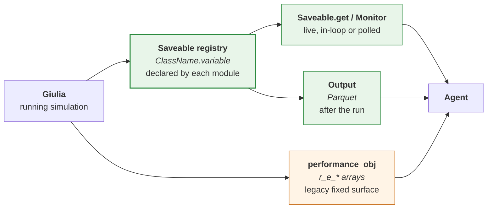
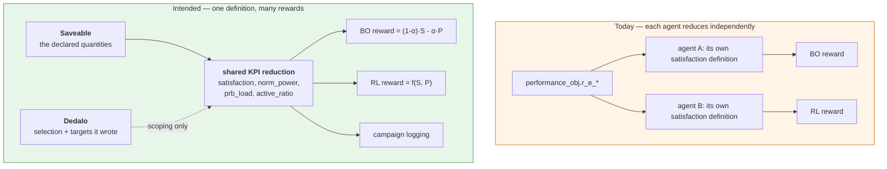

# Dedalo — KPIs and observations

Dedalo's write channel is only half of the loop. An agent also has to **read back** what its
configuration produced: a reward, an observation vector, a set of KPIs to log.

**Results are read through `Saveable`, not through Dedalo.** `Saveable` is the read path through
which the network state is observed; Dedalo is the write path through which it is configured.

This page therefore covers what the read path exposes, what the agents in this tree actually do
with it today, and which part of that is a Dedalo concern and which is not.

---

## 1. The read path



| Channel | Access | Latency | Status |
|---|---|---|---|
| **`Saveable.get`** | `Saveable.get("Class.var")`, keys from `Saveable.catalog()` | immediate, in the simulation thread | **the read path** — any declared quantity, no exporter change |
| **`Monitor`** | `Monitor(keys, stop_event)` | live, polled from a background thread | the read path, from outside the loop ([monitor](../output-saveable/SaveAble_monitor.md)) |
| **Output files** | Parquet under `outputs/` | end of run | the read path, persisted ([output](../output-saveable/saveable-output.md)) |
| **`performance_obj`** | `g.performance_obj.r_e_<name>` | immediately after `run_simulation` | **legacy fixed surface** — what the agents in this tree use today |

### Why `r_e_*` is the legacy surface, not the interface

`Performance.process()` fills **two** things, and the difference matters:

```python
# giulia/outputs/save_performance.py — process()

self.safe_append("r_e_total_network_power_consumption_kW", ...)   # hardcoded, named attribute

for saveable in _get_saveables():                                 # the declared quantities
    for var_name in saveable.expose_variables():
        self._safe_append_saveable(f"{saveable.name}.{var_name}",
                                   saveable.get_output(var_name))
```

The `r_e_*` attributes are a **predefined** set, written by name into the output module. A newly
exposed KPI does not appear among them — the output module has to be edited. That is precisely
the coupling the `SaveAble` mechanism was introduced to remove, and the corresponding NPZ
export is retained for backward compatibility only.

The second loop is the read path: everything a module declares lands in `r_e_saveables_data`
keyed `<ClassName>.<variable_name>`, and the same keys are readable live through
`Saveable.get()` and exported to Parquet without touching any exporter.

**Guidance for new code:** read through `Saveable.get()` (or `Monitor`, or the Parquet output).
Use `r_e_*` when extending an existing agent that already reads it, or when you need one of the
few quantities the output module assembles itself and no module declares (below, and §2).

### Known gap: quantities the legacy surface has and `Saveable` does not

Not everything in `r_e_*` has a declared equivalent yet, so the two surfaces are not
interchangeable today. The clearest case is the **network total power**, which is the reward
term of every energy-efficiency study in this tree:

| | Key | Available? |
|---|---|---|
| legacy | `performance_obj.r_e_total_network_power_consumption_kW` | ✅ read from `Power_Consumption.total_RAN_power_consumption_kW` by the output module |
| declared | `Power_Consumption.total_RAN_power_consumption_kW` | ❌ **not in `expose_variables()`** — `Saveable.get` returns `None` |

`Power_Consumption` declares only `power_consumption_per_radio_unit_kW`, `P_base_band_W` and
`power_consumption_per_radio_unit_incl_bbu_kW`. The network total is therefore reachable
through `Saveable` only by summing the per-radio-unit array — which is what the Parquet
`ru_kpi` dataset already contains.

*Verified against this tree; not a recommendation to change behaviour.* The clean fix is one
line in `expose_variables()` plus a label and a description, after which the total becomes
available to `Saveable.get`, the `Monitor`, and the Parquet output at once. Until then, check
`Saveable.catalog()` before assuming a legacy KPI has a declared counterpart.

---

## 2. What the legacy `performance_obj` exposes

Kept here because the agents in this tree read it, and because a few of its entries are
assembled rather than merely collected.

`performance_obj` is rebuilt by `configure()` and accumulates one entry per step. Every
attribute is prefixed `r_e_` (*results, episode*) and defined in
[`giulia/outputs/save_performance.py`](../../giulia/outputs/save_performance.py).

The full set available in this tree:

| Group | Attributes |
|---|---|
| **Energy** | `r_e_total_network_power_consumption_kW`, `r_e_power_consumption_per_radio_unit_kW`, `r_e_power_consumption_per_radio_unit_incl_bbu_kW`, `r_e_network_power_consumption_per_radioType_kW` |
| **Throughput** | `r_e_ue_throughput_based_on_eff_CSI_RS_SINR_per_PRB_Mbps`, `r_e_ue_throughput_based_on_ins_CSI_RS_SINR_per_PRB_Mbps`, `r_e_ue_throughput_per_carrier_Mbps`, `r_e_cell_throughput_Mbps`, `r_e_carrier_throughput_Mbps` |
| **Load / occupancy** | `r_e_PRB_usage_per_cell`, `r_e_cell_activity_per_ue`, `r_e_ues_per_cell_based_on_SSB`, `r_e_ues_per_cell_based_on_CRS`, `r_e_ues_per_SSB_beam`, `r_e_ues_per_CSI_RS_beam` |
| **Radio state** | `r_e_cell_radio_unit_statuses` |
| **Association** | `r_e_best_serving_cell_ID_per_ue_based_on_SSB`, `..._based_on_CRS`, `r_e_best_serving_SSB_per_ue`, `r_e_best_serving_CSI_RS_per_ue` |
| **Signal quality** | `r_e_effective_CSI_RS_sinr_ue_to_cell_dB`, `r_e_SSB_sinr_ue_to_cell_dB`, `r_e_CRS_sinr_ue_to_cell_dB`, `r_e_*_rsrp_per_ue_dBm`, `r_e_*_usefulPower_ue_dBm`, `r_e_*_interfPower_ue_dBm` |
| **Geometry** | `r_e_best_serving_SSB_distance_3d_m`, `r_e_best_serving_SSB_coupling_gain_dB`, and CRS equivalents |

### Shapes

Verified on a 2-step, 57-cell, 570-UE run:

```
r_e_cell_radio_unit_statuses                          -> (2, 57)    (steps, cells)
r_e_ue_throughput_based_on_eff_CSI_RS_SINR_per_PRB_Mbps -> (2, 570) (steps, UEs)
r_e_total_network_power_consumption_kW                -> (2,)       (steps,)
```

The leading axis is **steps within the current episode**. Running several episodes against the
same instance means collecting per episode and stacking yourself — which is exactly what the
BO environment's `_simulate` does, producing `(episodes, steps, UEs)`.

### A worked read

From [Worked examples § 2](./examples.md#2-a-minimal-dedalo-from-scratch) — 57 cells, every
third one shut down:

```
BASELINE: all cells active
   shutdown cells (last step) : 0
   total network power        : [27.447, 27.447] kW
   mean UE throughput         : 166.090 Mbps

ACTION: every 3rd cell shut down  (19 cells)
   shutdown cells (last step) : 19
   total network power        : [24.428, 24.428] kW
   mean UE throughput         : 122.523 Mbps

DELTA  power -11.0%   throughput -26.2%
```

That is the energy/QoS trade-off an optimizer searches over, in its rawest form.

---

## 3. The gap: derived KPIs are defined per-agent

No agent optimizes a raw `r_e_*` array. Each one reduces the arrays to a handful of scalars —
"satisfaction", "normalised power" — and *those* are the quantities that matter.

Those reductions are currently written **inside each agent, independently**, and nothing
guarantees that two agents use the same definition. A satisfaction score, for example, can cap
the rate-to-target ratio at 1 or penalise over-delivery, and it can average each UE's rate over
episodes and steps before forming the ratio or use the value of a single step. A normalised
power can be computed on the summed power of the selected cells or per radio and then averaged.
A number from one study can therefore not be compared with the same-named number from another
without checking both definitions.

---

## 4. Consolidating the derived definitions

Two things have to be kept apart here, and the read/write split is what separates
them:

- **Retrieving** a quantity the simulator computed — throughput, power, PRB usage. That is the
  read path, and it is `Saveable`'s job (§1). It is *not* a Dedalo concern.
- **Reducing** those quantities into a study's scalar objective — "satisfaction", "normalised
  power". That is the part currently defined inside each agent (§3).

So the open item is not "make Dedalo a read interface". It is "give the reduction one
definition, fed from the read path".

What Dedalo legitimately contributes to that reduction is **not the data but the
configuration context** — it is the component that knows which cells belong to which layer or
role, and what each UE's target rate was set to, because it set them.

That second point is the decisive one. `satisfaction` needs `ue_target_rate_Mbps`, which
[`setGiulia_ue_target_rate`](../../dedalo/dedalo_EE.py#L352) wrote. A power KPI scoped to a
subset of the network needs to know which rows are in that subset, which Dedalo knows because
it built the deployment. Agents instead re-derive it from array positions — a study that
appends one special cell asserts "it is the last row" — a convention that holds for one
deployment and is unchecked everywhere else.



The point is **not** to force one reward on every study. Reward shaping is the researcher's
business and differs legitimately between BO and RL. The point is that the *ingredients* —
what "satisfaction" means, how power is normalised, which rows are terrestrial — should have
one definition, so that two studies reporting "satisfaction = 0.87" mean the same thing.

### A concrete shape

Names are indicative; **where this layer lives is still open** — see the note below the table.

| Proposed member | Returns | Replaces |
|---|---|---|
| `kpi_satisfaction(per_ue=False)` | mean, or per-UE vector, of capped rate/target | the per-agent satisfaction blocks |
| `kpi_satisfaction_percentile(q)` | the tail statistic | the per-agent tail statistics |
| `kpi_power_normalized(cells=None)` | normalised power in `[0,1]` over a `df_ep`-selected subset, with a calibrated floor/range | the per-agent normalisers |
| `kpi_prb_load(cells=None)` | per-cell or aggregated PRB usage | the per-study telemetry readers |
| `kpi_active_ratio()` | fraction of radios not in `carrier_shutdown` | the ad-hoc ratios computed in each agent |
| `build_observation(keys)` | a dict of the above, by name | the per-agent observation builders |

> **Open: where it lives.** Hanging these off `Dedalo` is the convenient option — it already
> holds the bound instance and the selectors — but it would make Dedalo a read interface, which
> the read/write split says it is not. The alternative is a separate reduction
> module that takes `(saveable_reader, dedalo)` and stays on the read side of the split. Decide
> this before implementing; it is an architectural choice, not a naming one.

### Properties worth preserving

- **Cell/UE masks come from `df_ep`, not from positions.** `get_cell_names("cell_role", "coverage")`
  and `get_cell_names("RAT", "NR")` already exist and are index-independent; a KPI layer should
  select on them rather than on "the last row" or a hard-coded slice.
- **The averaging order is part of the definition.** Averaging per UE before forming the ratio
  changes the result. Whatever the shared definition is, it must state its reduction order
  explicitly and be documented alongside the formula.
- **Keep the raw quantities reachable.** A reduction layer should sit *beside* the read path,
  not in front of it — analysis code legitimately needs the full `(steps, UEs)` arrays, and
  `Saveable.get()` / the Parquet output must stay the way to obtain them.
- **Read the ingredients through `Saveable`.** A new reduction should take its inputs from the
  declared keys, so that a quantity added to a module becomes usable without editing the output
  module. Fall back to `r_e_*` only for the combined matrices the output module assembles
  itself (§2).

---

## See also

- [`output-saveable/saveable-catalog.md`](../output-saveable/saveable-catalog.md) — every Saveable key, per preset.
- [`output-saveable/SaveAble_monitor.md`](../output-saveable/SaveAble_monitor.md) — live KPI polling.
- [Worked examples § 6](./examples.md#6-how-the-real-agents-wire-in) — the delivered RL and BO examples and how they read results back.
