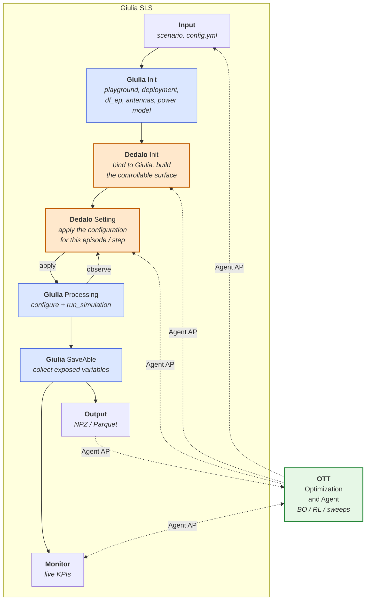
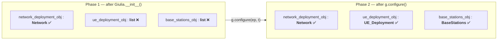
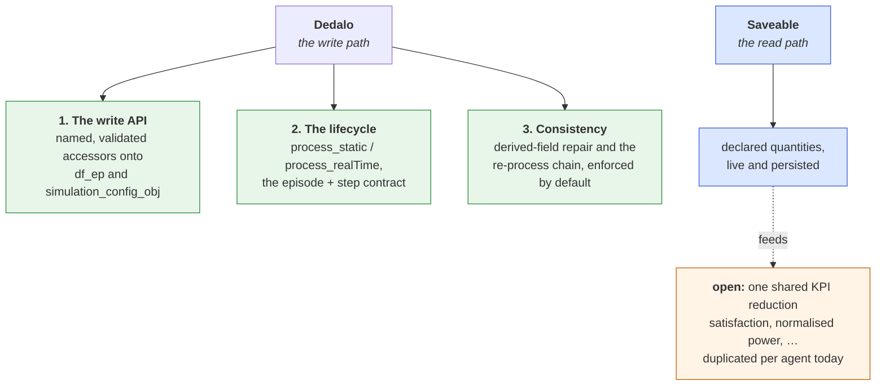

# Dedalo — Overview

This page explains **what Dedalo is, why it exists, and where it sits** in the Giulia
system-level simulator.

It is written for two audiences:

- **Human readers** who need to understand the design intent before extending it.
- **AI agents / developers** who need enough structural detail (classes, call order, data
  flow, failure modes) to navigate and change the code safely.

> **Acronyms used throughout**
> - **SLS** — System-Level Simulator (Giulia itself).
> - **`df_ep`** — *DataFrame of Engineering Parameters*: one row per cell (or per UE), one
>   column per configurable parameter. Giulia's central configuration table. See
>   [`df_ep` consistency](./df-ep-consistency.md).
> - **BS / UE** — Base Station / User Equipment.
> - **PRB** — Physical Resource Block, the smallest schedulable time–frequency unit.
> - **RAT** — Radio Access Technology (`LTE`, `NR`).
> - **RRM** — Radio Resource Management.
> - **OTT** — Over-The-Top: in this project, the external optimization and agent layer that
>   drives the simulator from outside.
> - **BO / RL** — Bayesian Optimization / Reinforcement Learning, the two agent families
>   that consume Dedalo today.

---

## 1. The problem Dedalo solves

Giulia is a modular simulator whose configuration lives in a large flat table: `df_ep`, the
engineering-parameter DataFrame, **57 cells × 96 columns** in a standard 5G scenario. Around
that table sits a chain of objects — antenna arrays, beam codebooks, the carrier grid, the
power model, the shadowing maps — each of which reads the table once, at construction, and
caches derived state.

That design is efficient, and it is fine as long as the configuration is written once and
then left alone. It stops being fine the moment an **external optimizer** enters the picture,
because an optimizer's entire job is to change the configuration, run, measure, and change it
again — hundreds or thousands of times.

The requirement is that external applications — optimization algorithms, machine-learning
frameworks, autonomous agents — can configure network parameters, trigger simulation runs, and
read selected network observations and KPIs through dedicated interfaces, without modifying
Giulia's internal simulation logic.

**Dedalo is the *configure* half of that dedicated interface.** It is the seam between "the
simulator" and "whatever is driving the simulator" — on the write side. The *observe* half is
`Saveable`, documented under [output-saveable](../output-saveable/README.md): `Saveable` is the
read path, Dedalo is the write path.

Without it, every agent reaches into `g.network_deployment_obj.df_ep` by hand, and every
agent re-derives — differently, and sometimes wrongly — the rules about which fields may be
written, which derived fields must be repaired afterwards, and which cached objects must be
re-processed. [§5](#5-why-a-bare-write-is-not-enough) shows what that costs, measured.

---

## 2. Where Dedalo sits in the pipeline

Giulia's block architecture puts Dedalo **inside** the Giulia SLS boundary, as two stages of
the main pipeline — not as an outside utility:

Three things in this picture carry the whole design:

1. **Dedalo occupies two stages, not one.** *Dedalo Init* runs once, when the controllable
   surface is established. *Dedalo Setting* runs repeatedly, once per episode and once per
   step. They correspond to `Dedalo.__init__` on one side and
   [`process_static`](../../dedalo/dedalo.py#L65) / [`process_realTime`](../../dedalo/dedalo.py#L69)
   on the other.

2. **The Dedalo ↔ Giulia Processing arrow is bidirectional.** Dedalo applies a configuration,
   Giulia runs, and Dedalo reads the resulting state back to decide the next setting. This is
   the closed loop that makes time-domain control studies possible — see
   [`set_dedalo_radio_status_from_giulia_runTime`](../../dedalo/dedalo_EE.py#L288), which reads
   each cell's live radio state out of the running `BaseStations` objects.

3. **Every agent hook that touches the pipeline lands on Dedalo.** The OTT agent has five
   access points, and of the three that *write*, two are the Dedalo stages. The agent never
   attaches to *Giulia Init*, *Giulia Processing*, or *SaveAble* directly. That is the
   architectural claim: **Dedalo is the write surface of the simulator.**

---

## 3. The Agent Access Point

The "Agent AP" edges in the diagram above mark the points where something outside the
simulator is allowed to reach in.
Grouping them makes the split obvious:

| Access point | Direction | What it is concretely |
|---|---|---|
| **Input** | agent → sim | Scenario choice, preset, YAML config. Chosen once per experiment. |
| **Dedalo Init** | agent → sim | Which cells/UEs exist, and which parameters this study may vary. |
| **Dedalo Setting** | agent ↔ sim | The per-episode / per-step decision. **This is the optimizer's action channel.** |
| **Monitor** | agent ↔ sim | Live KPI polling while the run proceeds ([`Monitor`](../output-saveable/SaveAble_monitor.md)). |
| **Output** | sim → agent | Persisted results read back after the run. |

The read channels (Monitor, Output) are already well-factored and documented under
[`output-saveable/`](../output-saveable/README.md). The **write** channel is Dedalo, and it is
what the rest of this documentation is about.

---

## 4. The two phases, and why the split matters

Giulia's execution splits into *initialization* and *processing*, and Dedalo's API splits
along the same seam. This is not a stylistic parallel — it is forced by what exists in memory
at each moment.

Giulia pre-declares its component slots as **empty lists** and fills them in as the pipeline
advances ([`g_standard_preset.py`](../../giulia/presets/g_standard_preset.py#L144)). Cell-side
objects are built in `__init__`; UE-side and link-side objects only appear in `configure()`.

Dedalo's type guards exist precisely to turn that into a clear error instead of an
`AttributeError` deep inside pandas. Verified against the live simulator:

| Dedalo API | Before `configure()` | After `configure()` |
|---|---|---|
| [`get_cell_names`](../../dedalo/dedalo.py#L277) | ✅ 57 cells | ✅ |
| [`giulia_number_of_cells`](../../dedalo/dedalo.py#L302) | ✅ `57` | ✅ |
| [`set_giulia_network_df_ep`](../../dedalo/dedalo.py#L73) | ✅ writes | ✅ |
| [`get_ue_names`](../../dedalo/dedalo.py#L289) | ❌ `TypeError` | ✅ 570 UEs |
| [`giulia_number_of_ue`](../../dedalo/dedalo.py#L317) | ❌ `TypeError` | ✅ `570` |
| [`set_giulia_ue_df_ep`](../../dedalo/dedalo.py#L223) | ❌ `TypeError` | ✅ writes |

> The error text on the UE-side failures reads *"Giulia has to be initialized first"*, which
> is misleading: Giulia **is** initialized. What has not happened is `configure()`. Read it as
> "the UEs do not exist yet".

The practical consequence for anyone writing a Dedalo subclass: **`process_static` runs before
`configure()`, so it can shape the network but not the UEs directly.** It influences the UE
population by writing the *counts* into `simulation_config_obj`
([`set_in_Giulia_ue_per_UEsite_cell`](../../dedalo/dedalo_EE.py#L274)), which `configure()` then
acts on. Per-UE attributes such as target rate can only be written afterwards — which is why
`Dedalo_UnRL` sets them in `process_realTime`, not `process_static`.

---

## 5. Why a bare write is not enough

The reason Dedalo must be a real interface — rather than a convention that everyone pokes
`df_ep` politely — is that `df_ep` is **not a flat set of independent knobs**. Some columns
are *derived* from others, and the objects built around the table cache their own copies.

A write that ignores either fact produces a simulation that is wrong but does not complain.

Measured on `GiuliaStd` / `3GPPTR38_901_5G`, halving every cell's downlink bandwidth from
100 MHz to 50 MHz (at 60 kHz subcarrier spacing, so 135 PRB → 65 PRB):

| Repaired derived field? | Re-processed the carrier object? | `df_ep` PRBs | Result |
|---|---|---|---|
| ✅ | ✅ | 65 | **84.4 Mbps** — correct |
| ✅ | ❌ | 65 | 💥 `RuntimeError: size of tensor a (65) must match tensor b (135)` |
| ❌ | ✅ | 135 | **175.5 Mbps** — silently wrong |
| ❌ | ❌ | 135 | **175.5 Mbps** — silently wrong |

The two bottom rows are the dangerous ones. They run to completion and report a mean UE
throughput **2.08× too high**, because the simulator is still using the 100 MHz resource grid
while `df_ep` claims 50 MHz. Nothing warns. An optimizer fed these numbers would confidently
converge on a configuration that does not exist.

The crash row, by contrast, is the *safe* failure — it is loud.

This single table is the argument for the whole design: **a correct modification to Giulia is
three coupled operations — write, repair, re-process — and the only way to stop callers
getting it wrong is to make the correct sequence the API.** The full derivation, the complete
list of derived fields, and the re-process rule are in
[`df_ep` consistency](./df-ep-consistency.md) and [The API contract § 5](./api.md#5-the-re-process-rule).

---

## 6. What Dedalo is responsible for

Pulling the above together, Dedalo owns **three** things — all of them on the write side of the
split. Reading results back is not among them: that is `Saveable`'s job, as
[KPIs and observations § 1](./kpis.md#1-the-read-path) sets out.

| Responsibility | Status | Where it is documented |
|---|---|---|
| **1. The write API** | Implemented — [`set_giulia_network_df_ep`](../../dedalo/dedalo.py#L73), [`set_giulia_ue_df_ep`](../../dedalo/dedalo.py#L223), the name/count accessors | [The API contract](./api.md) |
| **2. The lifecycle** | Implemented and universally followed by callers | [The API contract § 3](./api.md#3-the-lifecycle) |
| **3. Consistency** | Wired up — `Dedalo` methods over the checks in [`tests/`](../../tests/); the setter repairs derived columns by default | [`df_ep` consistency](./df-ep-consistency.md) |

Responsibility 3 is now wired up: `Dedalo` exposes the checks and repairs that live under
[`tests/`](../../tests/) as methods bound to its own instance, and `set_giulia_network_df_ep`
repairs derived columns by default.

**Adjacent, and still open:** the *reduction* of read-back quantities into a study's scalar
objective is reimplemented per agent today, with mutually incompatible definitions. That is a
real defect, but it is not a gap in Dedalo's responsibilities — the raw quantities are already
retrievable through `Saveable`. [KPIs and observations](./kpis.md) states exactly what differs,
and why where the shared reduction should live is an architectural decision rather than an
obvious extension of Dedalo.

---

## 7. Who uses Dedalo

Dedalo has no callers inside the simulator — by design. Its callers are the studies built on
top of it. In this repository:

| Caller | Kind | How it uses Dedalo |
|---|---|---|
| `examples/ott_integration/rl_integration.ipynb` | Reinforcement learning (Gymnasium-style environment) | `reset()` calls `process_static`, then `configure`; every step calls `process_realTime` before `run_simulation`, then reads the observation through `Saveable`. |
| `examples/ott_integration/bo_integration.ipynb` | Bayesian optimization (BoTorch) | For each episode, calls `process_static`, applies the candidate configuration through Dedalo before `configure`, then runs the steps with `process_realTime` before `run_simulation` and scores the configuration over the whole episodes. |

All of them follow the call sequence given in [the README](./README.md#the-contract-in-six-lines).

---

## Next

- **[The API contract](./api.md)** — every method, the lifecycle, and the re-process rule.
- **[`df_ep` consistency](./df-ep-consistency.md)** — the table, its derived fields, and the checks.
- **[KPIs and observations](./kpis.md)** — what to read back, and the definitions that need consolidating.
- **[Worked examples](./examples.md)** — runnable code, verified against this tree.
