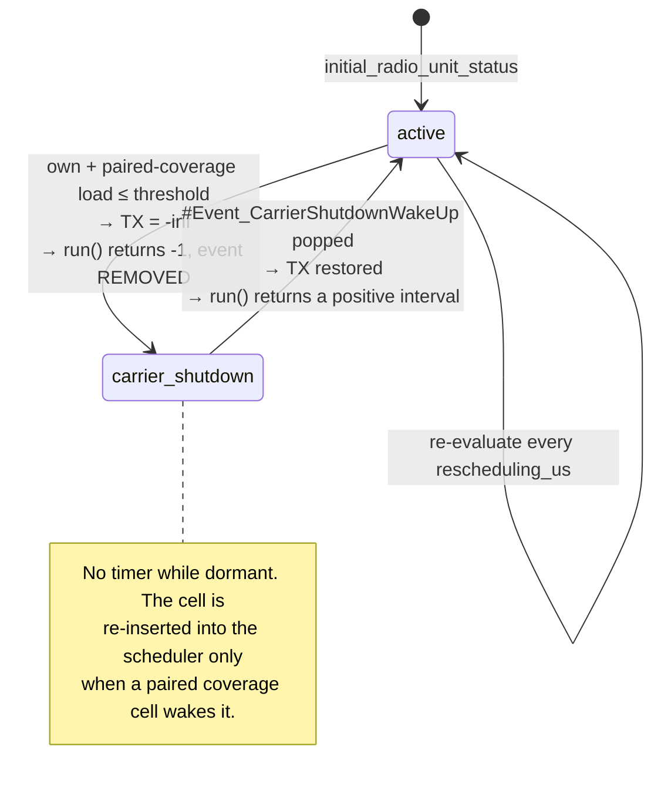
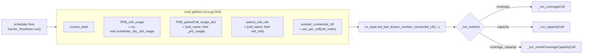
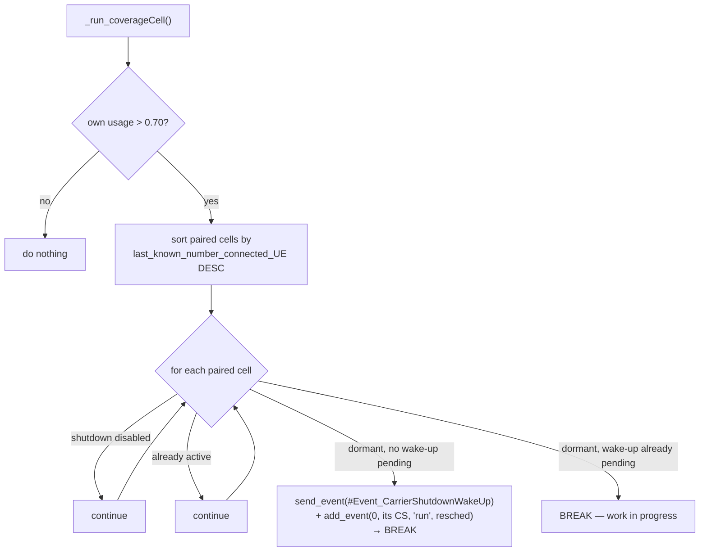

# Carrier Shutdown

**Carrier shutdown** is Giulia's energy-saving mechanism: a **capacity** cell switches
its radio carrier **off**, and switches it back **on** when the network needs it.
Coverage is preserved because the always-on **coverage** layer keeps serving the area.

All the logic is in [`Carrier_Shutdown`](../../giulia/rrc/rrcs.py#L245)
([`giulia/rrc/rrcs.py`](../../giulia/rrc/rrcs.py)). It depends on
[pairing](./pairing.md) and is one stage of the wider [RRM chain](./rrm.md).

`Carrier_Shutdown` is a **control function hosted by the
[`RRC`](../../giulia/rrc/rrcs.py#L23) layer**, not a peer of it — see
[The RRC layer § 0](./rrc-layer.md#0-the-mental-model-a-container-not-an-algorithm). That
division of labour is the thing to keep in mind while reading this page:

- **the function decides** — it owns the thresholds, the conditions and the state machine;
- **the layer stores** — the role, the pairing graph, the served-UE count the decision
  needs, and the resulting `radio_unit_status` the rest of the simulator reads;
- **the layer carries the messages** — when a coverage cell wakes a capacity cell, the
  exchange happens between the two cells' *RRC layers*, through the mailbox;
- **the layer acts on the radio** — the `BS_TX_Power` handle the function calls was handed
  to it by its layer, and the new status is mirrored back onto the layer before anything
  else in the network can observe it.

The same slot is where a channel- or symbol-shutdown function would go, with no change to
`RRC` itself.

> ⚠️ **The feature ships disabled.** Nothing in the `giulia` package ever sets
> `radio_enable_carrier_shutdown` to `True`. See [§7.1](#71-the-feature-ships-disabled)
> for exactly why, and how to turn it on.

---

## 1. The state machine

Each cell's carrier is in exactly one state, held in
`radio_unit_status_carrierShutdown` and mirrored onto `rrc_layer.radio_unit_status` by
[`set_radio_unit_status_carrierShutdown`](../../giulia/rrc/rrcs.py#L399). Every
transition is also appended to `radio_unit_status_carrierShutdown_memory`, giving a full
per-cell history for post-processing (measured: `['active', 'carrier_shutdown', 'active']`
across one cycle).

| State | Meaning | TX power |
|---|---|---|
| `"active"` | Radio on and serving. | The cell's configured power. |
| `"carrier_shutdown"` | Carrier off. | `-inf` dBm — exactly 0 mW. |



Only **capacity** cells ever leave `active`. Coverage cells assert it
([`rrcs.py:601`](../../giulia/rrc/rrcs.py#L601)).

---

## 2. Roles and thresholds

Roles are assigned by carrier frequency at deployment time — see
[Pairing § 1](./pairing.md#1-roles-come-first-and-they-come-from-frequency-alone). In the
`Carrier_Shutdown` constructor,
[`_set_role_specific_method_and_parameters`](../../giulia/rrc/rrcs.py#L297) reads the
per-cell thresholds out of `df_ep` and binds `self._run_method`:

| `cell_role` | Handler | Threshold read from `df_ep` | Default |
|---|---|---|---|
| `"coverage"` | [`_run_coverageCell`](../../giulia/rrc/rrcs.py#L490) | `carrier_wakeUp_pairedCell__currentCell_usage_threshold` | **0.70** |
| `"capacity"` | [`_run_capacityCell`](../../giulia/rrc/rrcs.py#L613) | `carrier_shutdown_currentCell_usage_threshold` | **0.30** |
| `"coverage_capacity"` | [`_run_mixedCoverageCapacityCell`](../../giulia/rrc/rrcs.py#L705) | both | — |

Any other value raises `ValueError`. Defaults are set in
[`set_dfEP_carrier_shutdown_attributes`](../../giulia/bs/bs_deployments.py#L454), and the
thresholds are **per cell**, so they can be varied across the network by writing into
`df_ep` — which is what [Dedalo](../dedalo/README.md) does
([`dedalo_EE.py:476-501`](../../dedalo/dedalo_EE.py#L476)).

The `"coverage_capacity"` role is **not** produced by
[`set_dfEp_coverage_capacity_cell_roles`](../../giulia/bs/bs_deployments.py#L424); only
Dedalo's HAPS workflow sets it ([§7.3](#73-the-mixed-role-and-haps-handlers-are-dedalo-paths-not-dead-code)).

---

## 3. The algorithm, step by step

Carrier shutdown is **distributed**: no central controller. Each cell runs
`Carrier_Shutdown.run` on its own timer (default 1e6 µs = 1 s simulated), and cells
coordinate through one-line events posted into each other's mailboxes.

### 3.1 `run()` — gather, then dispatch

[`Carrier_Shutdown.run`](../../giulia/rrc/rrcs.py#L343) collects the inputs and delegates
to the bound handler:



The UE count is cached on **every** tick, before the decision. That is deliberate: once a
cell shuts down it stops ticking, so the cached value freezes at the load it carried just
before switching off — which is what the coverage cell later sorts on to decide whom to
wake first.

`_get_number_connected_UE_pairedCell` ([`rrcs.py:429`](../../giulia/rrc/rrcs.py#L429)) is
also called, but it keys its dict by the constant string `"PRB_cell_activity"` and so
overwrites itself every iteration. Its result is passed to the handlers and **none of
them read it** — harmless today, but fix it before relying on per-paired-cell UE counts.

### 3.2 Capacity cell: the shutdown decision

[`_run_capacityCell`](../../giulia/rrc/rrcs.py#L613) decides only about itself.

The trigger is [`_is_shutdown_condition_met`](../../giulia/rrc/rrcs.py#L451):

```python
any(("coverage" in paired_cell_role)
    and (prb_usage + prb_usage_paired <= self.shutdown_currentCell_usage_threshold)
    for prb_usage_paired, paired_cell_role
    in zip(prb_usage_paired_dict.values(), paired_cell_role_dict.values()))
```

**Read that carefully — it is a single test on a sum, and it is inclusive.** Measured:

| own usage | paired coverage usage | sum | threshold 0.30 | result |
|---|---|---|---|---|
| 0.05 | 0.10 | 0.15 | ≤ | **shut down** |
| 0.15 | 0.15 | 0.30 | ≤ (equal) | **shut down** |
| 0.15 | 0.16 | 0.31 | > | stays active |
| 0.00 | 0.31 | 0.31 | > | stays active |
| 0.00 | 0.40 | 0.40 | > | stays active |

On shutdown the cell calls
[`shutdown_singleBS_tx`](../../giulia/bs/bs_tx_powers.py#L149), sets its state, and
**returns `-1`** — which makes the event scheduler *remove* its periodic event
([`eventDriven.py:215`](../../giulia/event_driven/eventDriven.py#L215)), measured. A
dormant capacity cell costs nothing and waits passively.

### 3.3 The property this rule really has

The last two rows of that table are the important ones, and they are easy to miss:

> **There is no independent test that the capacity cell is lightly loaded.** A capacity
> cell carrying *zero* traffic will refuse to shut down if its paired coverage cell is
> above 0.30 on its own. The coverage cell's load alone can veto every
> shutdown in its cluster, permanently, no matter how idle the capacity cells are.

That is a defensible design — it asks "can the coverage cell absorb the combined load?"
rather than "am I idle?" — but it means:

- the threshold is really a **budget for the merged pair**, not a capacity-cell idleness
  threshold, despite its name `carrier_shutdown_currentCell_usage_threshold`;
- in a busy network you may observe **no shutdowns at all** and the feature will look
  broken when it is doing exactly what it was written to do;
- raising `carrier_shutdown_currentCell_usage_threshold` above the coverage cell's
  typical load is the lever that re-enables shutdowns.

### 3.4 Coverage cell: the wake-up decision

[`_run_coverageCell`](../../giulia/rrc/rrcs.py#L490) never changes its own state; it wakes
dependants when congested. The trigger is
[`_is_wakeup_condition_met`](../../giulia/rrc/rrcs.py#L444): own PRB usage **strictly
greater than** 0.70.



Measured, with three dormant capacity cells holding 5 / 40 / 12 UEs and the coverage cell
above threshold:

- tick 1 wakes **cell 2** (40 UEs — the largest) and nobody else;
- ticks 2, 3, 4 are **no-ops** — the loop reaches cell 2 again, sees a pending wake-up, and
  `break`s;
- only once cell 2 has consumed its wake-up does the next tick reach cell 3 (12 UEs), then
  cell 1 (5 UEs).

So recovery is **strictly one cell per tick, largest first**. With the default 1 s cadence
a coverage cell needs *N* seconds of simulated time to bring *N* dormant cells back. Size
your simulation length accordingly — a run of a handful of steps cannot show a full
recovery.

Waking is two actions, both required:

1. `send_event(...)` posts `#Event_CarrierShutdownWakeUp` into the target's inbox;
2. `add_event(0, paired_rrc.carrier_shutdown_obj, 'run', rescheduling_us)`
   ([`rrcs.py:552`](../../giulia/rrc/rrcs.py#L552)) re-inserts the target's `run` at the
   *current* timestamp, so it processes the wake-up in the same step and resumes ticking.

The `break` on a pending wake-up is the anti-ping-pong guard described in the source
comment. It also means a wake-up that is never consumed **blocks recovery of every other
dependant** — which cannot happen on the default path, because step 2 guarantees
consumption within the same step, but would if `add_event` were ever removed.

### 3.5 Mixed role

[`_run_mixedCoverageCapacityCell`](../../giulia/rrc/rrcs.py#L705) does the coverage
behaviour then the capacity behaviour in one pass, guarded by

```python
assert not (condition_shutdown_flag and condition_wakeUp_paired)
```

With the shipped defaults (0.30 / 0.70) the two conditions are mutually exclusive and the
assertion is free. **Set the two thresholds so they overlap — for example shutdown 0.80,
wake-up 0.70 — and a mixed-role cell will abort the run.** Dedalo writes both thresholds
([`dedalo_EE.py:476`](../../dedalo/dedalo_EE.py#L476)) and is the caller most likely to hit this.

---

## 4. The role of pairing

- The **shutdown** test only looks at paired cells whose role contains `"coverage"`, so a
  capacity cell will not switch off unless a coverage cell it is paired with can take the
  combined load. Pairing is what makes that coverage cell the right one geometrically —
  the one this cell's UEs would actually re-associate to. See
  [Pairing § 4.2](./pairing.md#42-the-adjacency-matrix-what-the-presets-use).
- The **wake-up** loop only iterates `self.paired_rrc_layer`, so a coverage cell can only
  wake its own dependants.

The live graph (`paired_cells_idx`, `paired_rrc_layer`) is wired by
[`set_paired_cellIdx_and_rrcLayers`](../../giulia/rrc/rrcs.py#L96) after all RRC objects
exist — see [The RRC layer § 5](./rrc-layer.md#5-construction-and-scheduling).

---

## 5. Stability: there is no hysteresis

The shutdown test and the wake-up test are asked in **different currencies**:

- shutdown compares `own_usage + coverage_usage` — a sum across two cells;
- wake-up compares the coverage cell's usage **alone**.

And `_prb_usage` is a *fraction of that cell's own PRBs*
([RRM § 5](./rrm.md#5-_prb_usage-the-one-number-the-whole-feature-runs-on)), so the same
traffic is a different number on a 100 MHz capacity carrier than on a 10 MHz coverage
carrier. There is no hysteresis band, no dwell timer, and no minimum on/off period
anywhere in the class.

Put those together and the loop can close into a **one-tick limit cycle**. Measured, with
a 10 MHz coverage carrier, a 100 MHz capacity carrier, and traffic that costs 10× more PRB
fraction when it lands on coverage:

```
  t00  cov=0.05 cap=0.20 sum=0.25  ≤ 0.30  -> capacity OFF
  t01  cov=1.00 cap=0.00                   -> 1.00 > 0.70  -> capacity ON
  t02  cov=0.05 cap=0.20 sum=0.25  ≤ 0.30  -> capacity OFF
  ...
  state flips over 12 ticks : 11
  TX-power switch calls     : 12
```

The cell toggles on **every single tick** — which in a real network is thousands of
carrier transitions per hour, and in the simulator produces a power trace that averages to
something meaningless between the two states.

**This is not a hypothetical.** Asymmetric bandwidths between the coverage and capacity
layers are the normal case for exactly the deployments this feature targets.

Before trusting an energy-saving figure, check the switching rate:

```python
mem = bs.rrc_layer.carrier_shutdown_obj.radio_unit_status_carrierShutdown_memory
flips = sum(1 for a, b in zip(mem, mem[1:]) if a != b)
```

A flip count approaching the number of steps means you are measuring a limit cycle, not a
saving. Mitigations, in increasing order of invasiveness: widen the gap between the two
thresholds; express both tests in a common PRB-weighted currency (see
[RRM § 8](./rrm.md#8-if-you-are-changing-this-layer)); or add a dwell timer keyed on
`len(radio_unit_status_carrierShutdown_memory)`.

---

## 6. What it actually saves

[`Power_Consumption.calculate_power_consumption`](../../giulia/kpis/power_consumptions.py#L526)
turns state and load into watts. Per radio unit:

```
P_RU = P_0(state)
     + number_of_TX_transceivers × number_of_RF_chains × consumption_per_RF_chain_W
     + number_of_active_RF_chains × consumption_per_MCPA_W
     + (1/efficiency_of_MCPA) × Σ_cells (PRB_load × dBm_to_mW(TX_power))
```

Only **two** of those four terms respond to carrier shutdown, and the first one has a
catch:

1. **`P_0` drops only if *every* cell on the radio unit is shut down.** The test is
   `np.all(cell_status[positions] == 'carrier_shutdown')`
   ([`power_consumptions.py:553`](../../giulia/kpis/power_consumptions.py#L553)). One
   radio unit covers all sectors of a site on one layer — `radio_unit_ID` is
   `np.repeat(np.arange(n_sites), sectors_per_site)`
   ([`bs_deployments.py:525`](../../giulia/bs/bs_deployments.py#L525)), and the multilayer
   scenario gives each layer its own RU
   ([`bs_deployments.py:5268`](../../giulia/bs/bs_deployments.py#L5268)). So **all three
   sectors of a capacity site must sleep together** for the baseline saving.
2. **The transmit term is per cell** and vanishes immediately, because
   `dBm_to_mW(-inf)` is exactly `0.0`.
3. **RF-chain and MCPA terms are state-independent** — they are constant regardless of
   shutdown.
4. **BBU power is constant too.** `P_base_band_W` is a fixed per-BBU number (220 W for
   5G-Macro-BBU-v1) with no state dependence at all, so
   `power_consumption_per_radio_unit_incl_bbu_kW` dilutes whatever the radio saves.

Measured on a 5G-Macro-AAU-v1 radio unit carrying 3 cells at 20% load and 46 dBm:

| sectors shut down | RU power | saving vs all-on |
|---|---|---|
| 0 / 3 | 0.2359 kW | — |
| 1 / 3 | 0.2200 kW | **15.9 W** |
| 2 / 3 | 0.2040 kW | **31.8 W** |
| 3 / 3 | 0.1077 kW | **128.1 W** |

```
  P_0 (active)          171.00 W   -> 90.63 W only when ALL cells sleep  (Δ 80.37 W)
  RF chains  1×4×1.28W    5.12 W   -> unchanged
  MCPA       4×3.00W     12.00 W   -> unchanged
  transmit   (1/0.5)×…   47.77 W   -> the only per-cell term
```

**The saving is strongly non-linear: the third sector is worth five times the first two
combined.** Any study that shuts down scattered individual sectors will report a
disappointing figure; the win comes from putting a whole radio unit to sleep. This is the
single most important thing to know when interpreting a carrier-shutdown result.

### 6.1 Where the numbers come out

`power_consumption_per_radio_unit_kW`, `power_consumption_per_radio_unit_incl_bbu_kW` and
`P_base_band_W` are exported through the
[Saveable output system](../output-saveable/saveable-output.md) into the `ru_kpi` /
`bbu_kpi` datasets ([`expose_variable_labels`](../../giulia/kpis/power_consumptions.py#L67)).

> **`total_RAN_power_consumption_kW` is the exception.** It is *not* in
> `expose_variables()`, so it is not a Saveable key and putting it under `output.fields`
> matches nothing. It reaches the output through the hardcoded core-KPI path in
> [`save_performance.py`](../../giulia/outputs/save_performance.py), written into the
> `generic` dataset under the name **`total_network_power_consumption_kW`**.

> **Mind the one-step lag.** The power event is inserted before the RRC events, so a
> shutdown decided at step *k* first appears in the power KPI at step *k+1*.
> See [RRM § 6](./rrm.md#6-ordering-within-a-step).

---

## 7. Known limitations and flags

Real properties of the current code, surfaced so you don't mistake them for
documentation gaps.

### 7.1 The feature ships disabled

[`set_dfEP_carrier_shutdown_attributes`](../../giulia/bs/bs_deployments.py#L454) sets
`radio_enable_carrier_shutdown=False` for every cell — at line 492, directly under a
comment on line 490 reading *"Default initialization: Enable carrier shutdown for all
rows."* The comment and the code disagree; the code wins.

This is not overridable from a scenario builder either. `construct_data_frame` reads
`getattr(self, 'radio_enable_carrier_shutdown', False)`
([`bs_deployments.py:527`](../../giulia/bs/bs_deployments.py#L527)), but no scenario sets
that attribute, and `set_dfEP_carrier_shutdown_attributes` runs afterwards in
[`Network.process`](../../giulia/bs/bs_deployments.py#L123) (line 306) and clobbers the
column with `.assign()` regardless.

Consequence: [`initialize_eventDriven_RRC_layers`](../../giulia/bs/base_stations.py#L259)
never schedules a single `Carrier_Shutdown.run`. Nothing in `giulia/` re-enables it.

**To enable it**, write the flag after the `Giulia(...)` constructor (which runs
`network_deployment_obj.process()` and pairing) and before the first `g.configure(...)`
(which schedules the events):

```python
g = Giulia(preset, scenario_model, ...)

# Enable carrier shutdown on capacity cells only.
df_ep = g.network_deployment_obj.df_ep
df_ep.loc[df_ep["cell_role"] == "capacity", "radio_enable_carrier_shutdown"] = True
# The coverage cells must be enabled too — they are the ones that issue wake-ups.
df_ep.loc[df_ep["cell_role"] == "coverage", "radio_enable_carrier_shutdown"] = True

for episode_index in range(number_of_episodes):
    g.configure(episode_index, max_simulation_time_us)
    ...
```

Both roles need the flag: the capacity cell needs it to be scheduled at all, and
`_run_coverageCell` skips any dependant whose `enable_carrier_shutdown` is falsy
([`rrcs.py:528`](../../giulia/rrc/rrcs.py#L528)).

Also give the run enough steps. The EE example uses
`max_simulation_time_us = decision_making_interval_us = 1e6`, i.e. **one step** — one tick
of the algorithm, which can shut cells down but can never show a recovery.

*(The comment/code mismatch looks like a bug; it is flagged rather than documented as
intended.)*

### 7.2 `radio_unit_initial_status` is a no-op in the enable test

```python
condition_activate_carrier_shutdown = row['radio_enable_carrier_shutdown'].values[0] \
                                      and row['radio_unit_initial_status'].values[0]
```
([`base_stations.py:269`](../../giulia/bs/base_stations.py#L269))

`radio_unit_initial_status` is always the string `'active'` or `'carrier_shutdown'`
([`bs_deployments.py:528`](../../giulia/bs/bs_deployments.py#L528)) — both truthy — so the
second operand never changes the outcome. It reads as if it guards against scheduling a
cell that starts dormant, but it does not.

That matters because of an asymmetry: a cell that starts in `carrier_shutdown` finds no
wake-up in its inbox and returns a **positive** interval, so it keeps its timer and is
polled forever, whereas a cell that shuts down at run time returns `-1` and is
de-scheduled.

### 7.3 The mixed-role and HAPS handlers are Dedalo paths, not dead code

Both are unreachable from the `giulia` package alone, but [Dedalo](../dedalo/README.md)
reaches both:

- `"coverage_capacity"` is set by
  [`set_pairing_df_ep_as_per_terrestrial_haps_hierarchical`](../../dedalo/dedalo_EE.py#L374)
  (line 446), activating `_run_mixedCoverageCapacityCell`.
- [`_run_coverageCell_HAPS_multiple_wakeup`](../../giulia/rrc/rrcs.py#L869) is bound
  manually onto the last base station by
  [`_set_giulia_carrier_shutdown_method_HAPS`](../../dedalo/dedalo_EE.py#L670) (lines
  673-674), and the `cell_multiple_wakeup_id_dict` it needs is injected by
  [`_set_HAPS_RRC_multiple_wakeup_logic_paired_cells`](../../dedalo/dedalo_EE.py#L688)
  (line 713). Both are triggered from
  [`activate_haps_multiple_wakeup_logic`](../../dedalo/dedalo_EE.py#L663) at `step_index == 0`,
  and only for `singleHAPS` scenarios — anything else raises `NotImplementedError`.

Treat them as scenario-specific rather than dead. Changing `Carrier_Shutdown` means
changing Dedalo's HAPS workflow too.

### 7.4 One coverage cell per capacity cell

Neither runtime pairing model produces more. The wake-up code carries commented-out
branches for the multi-coverage case
([`rrcs.py:566-578`](../../giulia/rrc/rrcs.py#L566)) but the active path assumes one.
Dedalo's hierarchical pairing does append extra entries to `paired_cell` lists, so the
assumption is weaker than it looks.

### 7.5 Event-name matching is fragile

`_pop_specific_arrived_event` / `_exists_specific_event` compare
`specific_event_content.lstrip('#Event_')` against `content.split("_")[1]`. Both halves
are wrong in different ways and happen to agree for the single current event name. See
[The RRC layer § 3](./rrc-layer.md#the-mailbox).

### 7.6 Shutdown does not compose with external TX-power changes

A wake-up restores from `initial_BS_tx_power_dBm`, snapshotted on the first `process()`
call only, so a run-time power change made through `set_BS_tx_power_dBm` is discarded by
the next shutdown→wake cycle. See
[RRM § 4](./rrm.md#4-what-actually-happens-to-ues-when-a-carrier-is-shut-down).
