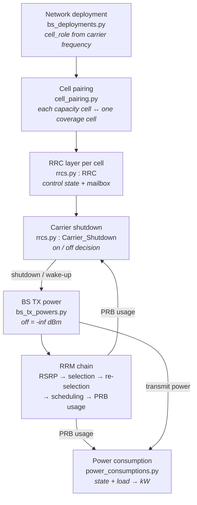

# Energy Efficiency in Giulia — Overview

This section documents Giulia's **energy-efficiency (EE)** features: the mechanisms that
reduce the power a radio access network consumes while still serving its users.

It is written for two audiences:

- **Human readers** who want to understand what the features do, how they fit together,
  and how far to trust a number that comes out of them.
- **Developers and agents** who need enough structural detail — classes, functions, file
  locations, data flow — to navigate and change the code safely.

> **Acronyms**
> **RAN** Radio Access Network · **RRM** Radio Resource Management · **RRC** Radio
> Resource Control · **BS** Base Station · **UE** User Equipment · **PRB** Physical
> Resource Block (the smallest schedulable chunk of time–frequency spectrum; "PRB usage"
> is the fraction of a cell's PRBs that are busy, in `[0, 1]`) · **RU / BBU** Radio Unit /
> Baseband Unit · **DL** Downlink · **HAPS** High Altitude Platform Station.

---

## 1. Read this first

Three things about the current state of the code determine what you can expect from it.
They are documented in detail on the pages below, but they belong at the top:

1. **Carrier shutdown ships disabled.** No cell has
   `radio_enable_carrier_shutdown = True`, so no shutdown events are scheduled and the
   algorithm does not run out of the box. Turning it on is a two-line change in the right
   place — see
   [Carrier shutdown § 7.1](./carrier-shutdown.md#71-the-feature-ships-disabled).
2. **The shutdown rule is a budget for the pair, not an idleness test.** A capacity cell
   carrying zero traffic will not switch off if its paired coverage cell is busy on its
   own. In a loaded network you may correctly observe no shutdowns at all — see
   [Carrier shutdown § 3.3](./carrier-shutdown.md#33-the-property-this-rule-really-has).
3. **The saving is dominated by whole-radio-unit sleep.** Shutting down one sector of a
   three-sector site saves ~16 W; shutting down all three saves ~128 W. Scattered
   single-sector shutdowns look disappointing for a structural reason, not a modelling
   error — see
   [Carrier shutdown § 6](./carrier-shutdown.md#6-what-it-actually-saves).

---

## 2. The pieces

| Feature | What it does | Primary code |
|---|---|---|
| **Cell roles** | Labels every cell *coverage* or *capacity* from its carrier frequency. | [`bs_deployments.py`](../../giulia/bs/bs_deployments.py) |
| **Cell pairing** | Links each capacity cell to the coverage cell that would absorb its users. | [`cell_pairing.py`](../../giulia/rrc/cell_pairing.py) |
| **RRC layer** | Per-cell control object and the inter-cell mailbox. | [`rrcs.py`](../../giulia/rrc/rrcs.py) |
| **Carrier shutdown** | Switches a lightly loaded capacity carrier off and back on. | [`Carrier_Shutdown`](../../giulia/rrc/rrcs.py#L245) |
| **RRM chain** | Association, re-selection, scheduling, load measurement — what *reacts* to a shutdown. | [`giulia/rrc/`](../../giulia/rrc/), [`giulia/mac/`](../../giulia/mac/) |
| **Power model** | Turns radio state and load into watts. | [`power_consumptions.py`](../../giulia/kpis/power_consumptions.py) |

The detailed pages:

- **[RRM](./rrm.md)** — the radio-resource-management chain the feature lives inside, and
  what actually happens to UEs when a carrier goes off.
- **[The RRC layer](./rrc-layer.md)** — classes, mailbox, construction, scheduling.
- **[Pairing](./pairing.md)** — how capacity cells are matched to coverage cells.
- **[Carrier shutdown](./carrier-shutdown.md)** — the algorithm, its stability, and what
  it saves.

---

## 3. How they fit together

The chain is **roles → pairing → RRC decision → TX power → RRM reaction → power model**,
and it is a *closed loop*: the load the decision reads back next step is the load its own
previous decision produced.

1. **Roles** — the lowest carrier frequency in the network becomes *coverage*, every
   higher one *capacity*
   ([`_compute_coverage_and_capacity_frequencies`](../../giulia/bs/bs_deployments.py#L394)).
2. **Pairing** — each capacity cell is paired with the coverage cell its UEs would
   actually fall back to, computed from a per-layer fallback adjacency matrix over a
   dedicated shadow-fading-free simulation
   ([`PairingCell`](../../giulia/rrc/cell_pairing.py#L38)).
3. **RRC decision** — each cell owns an [`RRC`](../../giulia/rrc/rrcs.py#L23) hosting a
   [`Carrier_Shutdown`](../../giulia/rrc/rrcs.py#L245) that inspects PRB usage on a timer
   and decides. Cells coordinate through one-line events in each other's mailboxes.
4. **TX power** — shutdown sets the cell's transmit power to `-inf` dBm. That is the
   *only* thing it does directly.
5. **RRM reaction** — `-inf` makes the cell's RSRP `-inf`, so selection and re-selection
   stop choosing it and its UEs migrate to the coverage layer, changing both cells' PRB
   usage. This is the substance of the feature; see [RRM § 4](./rrm.md#4-what-actually-happens-to-ues-when-a-carrier-is-shut-down).
6. **Power model** — [`Power_Consumption`](../../giulia/kpis/power_consumptions.py#L20)
   reads each cell's radio state and load and converts them to kilowatts.

---

## 4. The idea in one paragraph

Low-frequency **coverage** cells reach far and stay on. Higher-frequency **capacity**
cells add throughput where demand is high but cost power. Cell re-selection already
pushes UEs *up* onto the highest capacity layer they can receive, so a capacity cell is
lightly loaded precisely when few users can hear it. When such a cell's load *plus* its
paired coverage cell's load fits under a threshold, its carrier is **shut down** — its
transmit power goes to `-inf`, its UEs re-select down to the coverage layer, and its radio
draws the reduced `carrier_shutdown` baseline. When the coverage layer later exceeds its
own congestion threshold, it **wakes** one paired capacity cell per tick, largest first.

---

## 5. Where it runs

Giulia is event-driven ([`EventDrivenSimulation`](../../giulia/event_driven/eventDriven.py#L18)).
The energy-saving logic is not a separate loop — it is ordinary simulation events:

- Pairing runs **once**, in the preset's `__init__`, before any event exists.
- During `configure()`,
  [`initialize_eventDriven_RRC_layers`](../../giulia/bs/base_stations.py#L259) schedules a
  `Carrier_Shutdown.run` for every cell with the flag set.
- Each `run` returns the microseconds until it should run again; `-1` removes the event.
  The default cadence is `dflt_rescheduling_us = 1e6` µs — one second of simulated time
  ([`sim_config.py:717`](../../giulia/config/sim_config.py#L717)).
- Everything in the pipeline shares that cadence, so within a step the execution order is
  purely the preset's insertion order — see [RRM § 6](./rrm.md#6-ordering-within-a-step).

---

## 6. How savings are measured

[`Power_Consumption`](../../giulia/kpis/power_consumptions.py#L20) reads each cell's
`rrc_layer.radio_unit_status` and PRB load every step and produces:

- `power_consumption_per_radio_unit_kW` — radio-only power per RU,
- `P_base_band_W` — baseband power per BBU (a **constant**, not state-dependent),
- `power_consumption_per_radio_unit_incl_bbu_kW` — radio plus its BBU share,
- `total_RAN_power_consumption_kW` — network total.

The first three are exported through the
[Saveable output system](../output-saveable/saveable-output.md) into the `ru_kpi` and
`bbu_kpi` datasets ([`expose_variable_labels`](../../giulia/kpis/power_consumptions.py#L67)).
The PRB load that drives the model is exported too, as
[`BaseStations.prb_usage_per_cell`](../../giulia/bs/base_stations.py#L130) in `cell_kpi`,
so a saving can be read against the load that produced it.

> **`total_RAN_power_consumption_kW` is the exception.** It is *not* in
> `Power_Consumption.expose_variables()`, so it is not a Saveable key and putting it under
> `output.fields` matches nothing. It reaches the output through the hardcoded core-KPI
> path in [`save_performance.py`](../../giulia/outputs/save_performance.py), written into
> the NPZ archive as **`total_network_power_consumption_kW`** (in a standard run no `generic`
> Parquet dataset is written, so the network total is available only in the NPZ archive).

Two caveats before quoting a figure:

- **A one-step lag.** The power event fires before the shutdown decision, so a shutdown at
  step *k* first shows in the KPI at step *k+1*.
- **Check the switching rate.** The algorithm has no hysteresis, and with asymmetric
  layer bandwidths it can enter a one-tick limit cycle that averages to a meaningless
  number. `radio_unit_status_carrierShutdown_memory` gives the per-cell history — see
  [Carrier shutdown § 5](./carrier-shutdown.md#5-stability-there-is-no-hysteresis).
