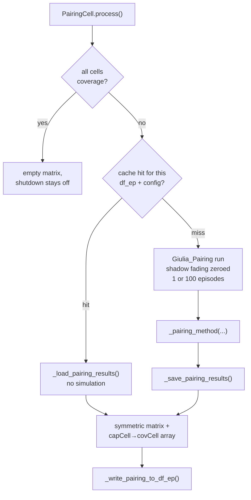

# Cell Pairing

**Pairing** answers one question for each **capacity** cell: *if I switch off, which
**coverage** cell picks up my users?* The answer is what makes
[carrier shutdown](./carrier-shutdown.md) safe — a capacity cell only powers down when a
cell it is paired with is verified to have room.

Primary code: [`giulia/rrc/cell_pairing.py`](../../giulia/rrc/cell_pairing.py)
(`PairingCell`). The role assignment it depends on lives in
[`giulia/bs/bs_deployments.py`](../../giulia/bs/bs_deployments.py).

---

## 1. Roles come first, and they come from frequency alone

Pairing needs to know which cells are coverage and which are capacity. That is decided
at deployment time, purely by carrier frequency:

- [`_compute_coverage_and_capacity_frequencies`](../../giulia/bs/bs_deployments.py#L394)
  sorts the unique downlink carrier frequencies and calls the **lowest** one the
  *coverage* frequency; **every** higher frequency is a *capacity* frequency.
- [`set_dfEp_coverage_capacity_cell_roles`](../../giulia/bs/bs_deployments.py#L424)
  writes the `cell_role` column into the engineering-parameter table `df_ep`.

| Role | Frequency | Why | In carrier shutdown |
|---|---|---|---|
| **coverage** | the single lowest carrier | Propagates further, penetrates buildings better. | **Never shut down.** Detects congestion and issues wake-ups. |
| **capacity** | every higher carrier | More bandwidth, shorter reach. | **Can be shut down**; woken on demand. |

Three properties of this rule matter downstream:

1. **It is frequency-based, not geometry-based.** A physically tiny 3.5 GHz small cell
   and a 3.5 GHz macro get the same role.
2. **There is exactly one coverage layer**, however many frequencies exist. With
   0.7 / 3.5 / 26 GHz, *both* 3.5 and 26 are capacity, and both compete to pair with the
   single 0.7 GHz layer.
3. **Nothing re-derives it.** Every later stage reads `cell_role` from `df_ep`, so
   overwriting that column (as [Dedalo](../dedalo/README.md) does — see
   [§6](#6-what-dedalo-does-to-pairing)) genuinely changes behaviour.

If **all** cells are coverage (a single-frequency deployment) there is nothing to pair;
both [`PairingCell.process`](../../giulia/rrc/cell_pairing.py#L88) and
[`set_dfEP_carrier_shutdown_attributes`](../../giulia/bs/bs_deployments.py#L454) return
early and shutdown stays disabled.

---

## 2. Where pairing runs

`PairingCell` is constructed and run inside the preset's **`__init__`**, not
`configure()` — so it happens **once per `Giulia(...)` object**, not once per episode:

- Standard preset: [g_standard_preset.py:241-245](../../giulia/presets/g_standard_preset.py#L241)
- Multi-frequency-layer preset: [g_multi_frequency_layer_preset.py:236](../../giulia/presets/g_multi_frequency_layer_preset.py#L236)

```python
pairing_cell_obj = cell_pairing.PairingCell(
    self.simulation_config_obj,
    self.site_deployment_obj,
    self.ue_playground_deployment_obj,
    self.ue_hotspot_deployment_obj,
    self.network_deployment_obj,
    pairing_model_type="adjacency_neighbouring_matrix_cellLevel_FallBack_PerLayer")
pairing_cell_obj.process()   # fills df_ep['paired_cell']
```

The practical consequence: **`df_ep["paired_cell"]` is already populated by the time the
constructor returns.** Anything that wants to inspect or override the pairing graph — or
enable carrier shutdown — has a window between `Giulia(...)` and the first
`g.configure(...)`.

---

## 3. What pairing writes

[`_write_pairing_to_df_ep`](../../giulia/rrc/cell_pairing.py#L584) fills a single
`df_ep` column, `paired_cell`, with a **deliberately asymmetric** encoding:

| Cell | `paired_cell` value | Meaning |
|---|---|---|
| capacity | `[cov_idx]` — a **one-element list** | the coverage cell that backs it |
| coverage, with dependants | `[cap_idx, cap_idx, …]` | every capacity cell that named it |
| coverage, with none | `None` (left untouched) | nothing paired to it |

Note the capacity entry is a *list of one*, not a bare integer — the loop at
[`cell_pairing.py:613`](../../giulia/rrc/cell_pairing.py#L613) wraps it explicitly so
both roles store the same type.

`None` is load-bearing: [`BaseStations.process`](../../giulia/bs/base_stations.py#L218)
skips those rows (`if paired_cell_list is None: continue`), so such a coverage cell keeps
an empty `paired_rrc_layer` and can never wake anybody. That is the correct outcome, but
it is silent — a coverage cell that ends up with no dependants simply does nothing for
the rest of the run.

Two more outputs are kept on the instance for external consumers:

- `pairing_CovCap_cell_matrix` — a symmetric `(N_cells, N_cells)` boolean matrix.
- `capCell_paired_covCell` — the paired coverage index per capacity cell.
- `adjacency_neighbouring_matrix` — set only by the adjacency model; `None` otherwise.

`paired_cell` is then read once, at
[`BaseStations.process`](../../giulia/bs/base_stations.py#L161), and converted into live
object references by [`set_paired_cell`](../../giulia/bs/base_stations.py#L388) →
[`set_paired_cellIdx_and_rrcLayers`](../../giulia/rrc/rrcs.py#L96).

---

## 4. The two pairing models

`pairing_model_type` selects one, validated against `available_models_type` and bound by
[`_set_pairing_method`](../../giulia/rrc/cell_pairing.py#L251):

| `pairing_model_type` | Method | Question it asks |
|---|---|---|
| `adjacency_neighbouring_matrix_cellLevel_FallBack_PerLayer` | [`_pair_by_reported_RSRP__adjacencyMatrixPerLayer`](../../giulia/rrc/cell_pairing.py#L395) | *Where would my UEs actually go if I vanished?* |
| `per_capacity_cell__best_coverage_cell_most_reported` | [`_pair_by_reported_most_frequent`](../../giulia/rrc/cell_pairing.py#L314) | *Which coverage cell do most of my UEs hear best?* |

> **The constructor default is not what runs.**
> `per_capacity_cell__best_coverage_cell_most_reported` is the default value of the
> `pairing_model_type` argument
> ([`cell_pairing.py:46`](../../giulia/rrc/cell_pairing.py#L46)), but **both presets pass
> the adjacency model explicitly**. The majority-vote model only runs if you construct
> `PairingCell` yourself and omit the argument — and [§4.5](#45-the-majority-vote-model-and-its-beam-indexing-defect)
> explains why you should not.



### 4.1 The controlled pairing run

Pairing should reflect *structural* geometry, not one random snapshot, so
[`_init_and_run_giulia_pairing`](../../giulia/rrc/cell_pairing.py#L262) spins up a
dedicated simulation through the `Giulia_Pairing` preset with two deliberate choices:

- **Shadow fading is zeroed** on every per-frequency shadowing map
  ([`cell_pairing.py:278-281`](../../giulia/rrc/cell_pairing.py#L278)), so reported RSRP
  depends only on path loss and antenna pattern.
- **Averaging over realizations:** `N_episode = 1 if ue_distribution == "grid" else 100`.
  A grid is deterministic so one episode suffices; otherwise 100 episodes of RSRP are
  concatenated along the UE axis.

Invisible `(UE, beam)` pairs are floored from `-inf` to a `-200` sentinel
([`cell_pairing.py:306`](../../giulia/rrc/cell_pairing.py#L306)) so later `max`
comparisons stay finite.

> **`Giulia_Pairing` does not build its own deployment.** The class in
> [`_g_pairing_preset_new.py`](../../giulia/presets/_g_pairing_preset_new.py#L35) takes the
> site, UE playground, hotspot and network objects as keyword arguments.
> `PairingCell` passes the main simulation's ones
> ([`cell_pairing.py:266`](../../giulia/rrc/cell_pairing.py#L266));
> [`dedalo/dedalo_EE.py`](../../dedalo/dedalo_EE.py#L777) builds a separate 4G-only set first.

> **The 100-episode average only reaches one of the two models.**
> `_init_and_run_giulia_pairing` returns `(giulia_pairing, RSRP_dBm_all_realization)`.
> The adjacency model consumes `RSRP_dBm_all_realization`. The majority-vote model
> ignores it entirely and reads `giulia_pairing`'s live object instead — i.e. **only the
> last of the 100 episodes**. See
> [§4.5](#45-the-majority-vote-model-and-its-beam-indexing-defect).

### 4.2 The adjacency matrix (what the presets use)

[`_compute_adjacency_per_layer`](../../giulia/rrc/cell_pairing.py#L461) builds an
`(N_cells, N_cells)` float matrix. For each cell *i*:

1. Take the UEs currently served by *i* (highest per-cell RSRP).
2. Mask *i* out with `-inf`.
3. **Within each frequency layer separately**, find each UE's next-best cell.
4. Row *i*, restricted to that layer, is the **fraction** of *i*'s UEs that would land on
   each cell of that layer.

So **each row sums to 1 within every layer** — including the cell's own layer.
The matrix is a per-layer fallback distribution, not a similarity score.

A worked 4-cell example — cells 0,1 at 0.7 GHz (coverage), cells 2,3 at 3.5 GHz
(capacity):

```
            to_0  to_1  to_2  to_3
  from_0     0.0   1.0   1.0   0.0
  from_1     1.0   0.0   0.0   1.0
  from_2     0.5   0.5   0.0   1.0      <- cell 2's UEs split evenly across the
  from_3     0.0   1.0   1.0   0.0         coverage layer, and all go to cell 3
                                            within the capacity layer
```

[`_compute_most_neighbour_per_layer`](../../giulia/rrc/cell_pairing.py#L522) reduces this
to booleans by taking the `argmax` per (row, layer) — one `True` per layer per row. The
pairing step then reads only the coverage-layer columns
([`cell_pairing.py:424`](../../giulia/rrc/cell_pairing.py#L424)).

> `mask_target_layer` at [`cell_pairing.py:427`](../../giulia/rrc/cell_pairing.py#L427) is
> an all-`True` placeholder, marked in the source as a hook for restricting pairing to a
> target layer. It has no effect today.

### 4.3 Why "fallback" and not "strongest neighbour"

The distinction is the point of the model. "Strongest neighbour" would rank coverage
cells by raw RSRP as seen from the capacity cell's location. "Fallback" ranks them by
**how many of this cell's actual UEs would end up there** — which is what determines the
load the coverage cell inherits. For a sectorised capacity cell whose UEs sit off to one
side, these give different answers, and the load-weighted one is the one the shutdown
condition needs.

### 4.4 The silent fallback when a cell has no UEs

If a capacity cell is nobody's best server, its adjacency row stays all-zero
([`cell_pairing.py:493`](../../giulia/rrc/cell_pairing.py#L493) `continue`s). Then:

- `_compute_most_neighbour_per_layer` takes `argmax` of an all-zero slice → index `0`;
- the pairing step takes `argmax` of the resulting all-`False` coverage slice → index `0`;
- the cell is paired to **the first coverage cell in index order, on zero evidence**.

The guard at [`cell_pairing.py:443`](../../giulia/rrc/cell_pairing.py#L443) —
`assert not np.isnan(capCell_paired_covCell).any(), "Some capacity cell was left unpaired"` —
**cannot fire**, because every slot is unconditionally assigned inside the loop and
`argmax` always returns a valid index. It is dead code.

This is not hypothetical: a capacity cell that is shadowed, mis-tilted, or simply out of
the UE drop area will hit it. The symptom is a plausible-looking pairing that ties a cell
to a geographically unrelated coverage cell, which then blocks or permits its shutdown
for no physical reason. **If you suspect it, check for all-zero rows in
`pairing_cell_obj.adjacency_neighbouring_matrix` restricted to the coverage columns.**

### 4.5 The majority-vote model and its beam-indexing defect

[`_pair_by_reported_most_frequent`](../../giulia/rrc/cell_pairing.py#L314) is simpler: for
each capacity cell, find its UEs, ask each which coverage cell it hears best, and take the
mode.

It has three problems, all measured, which is why the presets do not use it:

1. **It indexes beam columns with cell indices.** `reported_RSRP_ue_to_cell_dBm` has shape
   `(N_ue, N_beams_total)`, but line 368 slices it with `idx_Cov_cell`, which holds *cell*
   indices:

   ```python
   rsrp_covCell_per_ue_reported_dB = reported_RSRP_ue_to_cell_dBm[connected_ue][:, idx_Cov_cell]
   ```

   With one SSB beam per cell the two index spaces coincide and the result is correct.
   With two beams per cell, `idx_Cov_cell = [0, 1]` selects **both beams of cell 0** and
   never looks at cell 1 — producing a wrong pairing even when every UE hears cell 1
   about 30 dB better. The adjacency model avoids this by collapsing beams to
   cells first, in [`_compute_rsrp_cell_matrix`](../../giulia/rrc/cell_pairing.py#L552).

   This is latent in most scenarios but not all — 10 of the 34 scenario builders in
   `bs_deployments.py` configure more than one SSB beam per cell, including
   `3GPPTR38_901_UMa_C1/C2`, `3GPPTR38_901_UMi_C1/C2`, the C-band and FR3 large-scale
   cases, and `3GPPTR38_811_Dense_Urban_HAPS_UPA`.

2. **A capacity cell with no UEs crashes it.** `np.bincount([]).argmax()` raises
   `ValueError: attempt to get argmax of an empty sequence`
   ([`cell_pairing.py:374`](../../giulia/rrc/cell_pairing.py#L374)) — measured. The
   adjacency model silently mis-pairs in the same situation (§4.4); this one stops the run.

3. **Its "unassigned" sentinel is not NaN.**
   `np.full_like(idx_Cap_cell, np.nan)` on an `int32` array fills with `INT32_MIN`, not
   NaN ([`cell_pairing.py:361`](../../giulia/rrc/cell_pairing.py#L361)) — measured. There
   is no unpaired assertion here at all, so an unfilled slot would index the pairing
   matrix with `-2147483648`.

4. **It sees one episode, not 100** — see the note in [§4.1](#41-the-controlled-pairing-run).

---

## 5. The results cache

A pairing run is expensive, so `process()` memoises it on disk.

- [`_compute_pairing_cache_key`](../../giulia/rrc/cell_pairing.py#L200) fingerprints the
  `df_ep` content **together with** `pairing_model_type`, `ue_playground_model`,
  `ue_distribution` and `wraparound`, so two configurations sharing `df_ep` but differing
  in model do not collide.
- [`_save_pairing_results`](../../giulia/rrc/cell_pairing.py#L224) /
  [`_load_pairing_results`](../../giulia/rrc/cell_pairing.py#L239) store `.npy` files
  under `data/pairing_sym_results/<key>/`.
- A miss, or a partially written entry (`FileNotFoundError`, `ValueError`, `EOFError`,
  `OSError`), transparently recomputes.

> **Editing pairing code does not invalidate the cache.** The key covers *inputs*, not the
> implementation. After changing any `_pair_by_*` or `_compute_*` method you must delete
> the relevant folder under `data/pairing_sym_results/` or you will silently keep reading
> the old answer.

> **The Saveable side effect, and why `process()` has a `finally`.**
> `Giulia_Pairing.__init__` calls `Saveable.disable()` so its throw-away RSRP objects do
> not replace the caller's in the registry — and it can only ever restore "off", because
> its own `Simulation_Config` is always built with `enable_saveable=False`.
> `process()` therefore snapshots `Saveable.is_enabled()` before the try block and puts it
> back in a `finally` ([`cell_pairing.py:128-163`](../../giulia/rrc/cell_pairing.py#L128)),
> covering the cache-hit path too. Without that restore, every Saveable the main
> simulation creates afterwards — all the KPI objects, built later in `configure()` —
> would silently skip registration and the run would export no KPI Parquet at all. See
> [Saveable Objects](../source/saveable-objects.rst).

---

## 6. What Dedalo does to pairing

[Dedalo](../dedalo/README.md) is the one caller that rewrites the pairing graph after the
fact, and it does things the two models above never produce:

- [`set_pairing_df_ep_as_per_terrestrial_haps_hierarchical`](../../dedalo/dedalo_EE.py#L374)
  appends the HAPS index to `paired_cell` lists and sets `cell_role` to
  **`"coverage_capacity"`** for coverage cells — activating
  [`_run_mixedCoverageCapacityCell`](../../giulia/rrc/rrcs.py#L705), which the default
  deployment never reaches.
- [`set_pairing_df_ep_AllConnectedHierarchical`](../../dedalo/dedalo_EE.py#L506) pairs the
  HAPS with every cell.
- [`_set_HAPS_RRC_multiple_wakeup_logic_paired_cells`](../../dedalo/dedalo_EE.py#L688)
  injects `cell_multiple_wakeup_id_dict` and rebinds `_run_method` to
  [`_run_coverageCell_HAPS_multiple_wakeup`](../../giulia/rrc/rrcs.py#L869).

So the "one coverage cell per capacity cell" invariant below holds for the **runtime
pairing models**, not for the codebase as a whole.

---

## 7. How pairing feeds the shutdown decision

- The **shutdown** test
  ([`_is_shutdown_condition_met`](../../giulia/rrc/rrcs.py#L451)) iterates only paired
  cells whose role contains `"coverage"`, and requires
  `own_usage + that_cell_usage <= threshold`. Pairing is what guarantees the coverage cell
  in that sum is the one this cell's UEs would actually reach.
- The **wake-up** loop ([`_run_coverageCell`](../../giulia/rrc/rrcs.py#L490)) iterates only
  `self.paired_rrc_layer`, so a coverage cell can only wake its own dependants.

Note the shutdown test zips `PRB_pairedCell_usage_dict.values()` against
`paired_cell_role_dict.values()` ([`rrcs.py:481`](../../giulia/rrc/rrcs.py#L481)). Both
dicts are built from the same `self.paired_rrc_layer` iteration and keyed by
`rrc.cell_name`, so the alignment holds — **unless two cells share a `cell_name`**, in
which case both dicts silently collapse and the zip misaligns. Cell names are unique in
every shipped scenario (`'cell_%d' % x`), but this is worth knowing before generating
names yourself.

---

## 8. Interfaces & flags

- **Add a pairing model:** add a branch in
  [`_set_pairing_method`](../../giulia/rrc/cell_pairing.py#L251) and its name to
  `available_models_type` ([`cell_pairing.py:68`](../../giulia/rrc/cell_pairing.py#L68));
  implement a method taking `**kwargs` (it receives `giulia_pairing` and
  `RSRP_dBm_all_realization`) and returning
  `(pairing_CovCap_cell_matrix, capCell_paired_covCell)`. The name feeds the cache key, so
  an existing cache will not be reused.
- **Collapse beams before comparing cells.** Any new model that reads
  `RSRP_ue_to_cell_dBm` must go through
  [`_compute_rsrp_cell_matrix`](../../giulia/rrc/cell_pairing.py#L552) or repeat its logic
  — see [§4.5](#45-the-majority-vote-model-and-its-beam-indexing-defect).
- **Consumer contract:** keep per-capacity = one-element list, per-coverage = list of
  dependants, unused coverage = `None`, or update
  [`BaseStations.process`](../../giulia/bs/base_stations.py#L218) too.
- **Multiple coverage cells per capacity cell** is not produced by either runtime model.
  The wake-up code carries commented-out branches for that case
  ([`rrcs.py:566-578`](../../giulia/rrc/rrcs.py#L566)) but the active path assumes one.
- **Invalidating the cache:** delete the folder under `data/pairing_sym_results/`, or
  change an input that feeds
  [`_compute_pairing_cache_key`](../../giulia/rrc/cell_pairing.py#L200).
