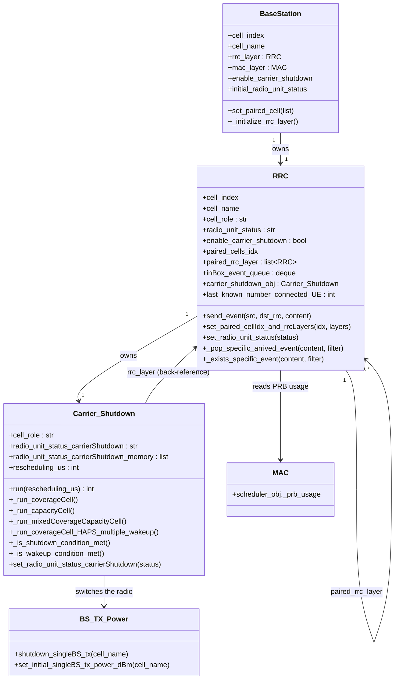
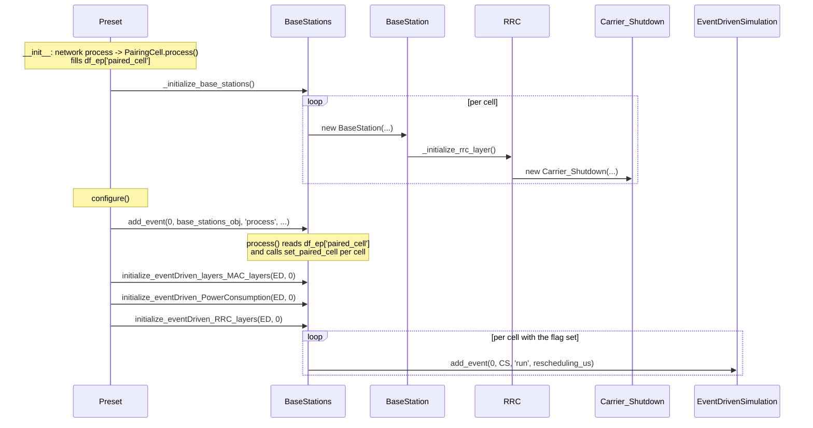

# The RRC Layer

**RRC = Radio Resource Control.** In a real network it is the control-plane layer that
manages radio resources and the lifecycle of a UE's connection. In Giulia it is the
per-cell control object that owns the energy-efficiency decisions and lets cells
coordinate by exchanging short messages.

This page is about the **plumbing**: the classes, their responsibilities, the interfaces
you would touch, and how they are constructed and scheduled.

- The shutdown *decision* is in [Carrier shutdown](./carrier-shutdown.md).
- The wider *radio-resource-management chain* this sits inside — association,
  re-selection, scheduling, load measurement — is in [RRM](./rrm.md).
- How the pairing graph gets built is in [Pairing](./pairing.md).

---

## 0. The mental model: a container, not an algorithm

Read `RRC` as **the RRC layer of one base station**, and read it as a *container*.

It hosts control functions and gives them the services they need. It does not contain
any of their logic. The layer defines no threshold, evaluates no condition and takes no
decision — search `rrcs.py` for a comparison operator inside the `RRC` class and you will
not find one. Its three jobs are:

1. **Store the control information of the cell** — role, radio status, pairing graph,
   served-UE count. Everything in [§3](#3-the-rrc-class).
2. **Manage the message exchange between cells** — the mailbox. When two cells coordinate,
   it is their *RRC layers* that talk, never the hosted functions directly.
3. **Act the variation on the cell** — the layer holds the handle to `BS_TX_Power` and owns
   the `radio_unit_status` attribute that the rest of the simulator reads. A hosted
   function decides; the effect reaches the network through the layer.

`Carrier_Shutdown` is the one hosted function implemented today. Others acting at
different resource granularities — channel shutdown, symbol shutdown — belong in the same
slot: a class constructed by `RRC.__init__`, holding a back-reference to its layer,
reading the network only through that back-reference, and scheduled independently by
`initialize_eventDriven_RRC_layers`. Adding one should not require touching `RRC` itself.

The consequences of that split are load-bearing and worth stating explicitly:

- **A hosted function never reaches into another cell.** It reads its own cell through
  `self.rrc_layer` (`rrc_layer.mac_layer.scheduler_obj._prb_usage`) and learns about other
  cells only from what arrives in its layer's mailbox, or from the paired `RRC` objects
  its layer holds.
- **The network only ever sees `rrc_layer.radio_unit_status`.**
  [`power_consumptions.py:532`](../../giulia/kpis/power_consumptions.py#L532) builds its
  state array from `bs_obj.rrc_layer.radio_unit_status` — not from
  `carrier_shutdown_obj.radio_unit_status_carrierShutdown`. A decision that is not mirrored
  onto the layer is invisible, which is why
  `set_radio_unit_status_carrierShutdown` writes through to the layer and why calling
  `set_radio_unit_status` directly desynchronises the two ([§3](#setters-and-getters-used-by-the-algorithm)).
- **The radio handle belongs to the layer.** `bs_tx_power_obj` is passed *into* `RRC` by
  the `BaseStation` and *from* `RRC` into `Carrier_Shutdown`
  ([rrcs.py:78](../../giulia/rrc/rrcs.py#L78)). The function calls
  `shutdown_singleBS_tx` through a reference it was handed by its container.

---

## 1. Scope of `giulia/rrc/`

The package holds more than RRC. Only `rrcs.py` and `cell_pairing.py` are about energy
efficiency; the rest is RRM configuration, catalogued in
[RRM § 2](./rrm.md#2-what-lives-in-giuliarrc).

This page covers [`rrcs.py`](../../giulia/rrc/rrcs.py), which defines two classes:
`RRC` (per-cell control plane + mailbox) and `Carrier_Shutdown` (the on/off state
machine).

---

## 2. Class structure

- One [`RRC`](../../giulia/rrc/rrcs.py#L23) per cell, owned by a
  [`BaseStation`](../../giulia/bs/base_stations.py#L323).
- Each `RRC` constructs exactly one
  [`Carrier_Shutdown`](../../giulia/rrc/rrcs.py#L245) in its constructor
  ([rrcs.py:78](../../giulia/rrc/rrcs.py#L78)) — **unconditionally**, whether or not the
  cell has shutdown enabled. The flag only gates whether an *event* is scheduled.
- An `RRC` holds direct references to its paired cells' `RRC` objects, so a cell reads a
  neighbour's live state and posts into its mailbox without going through the scheduler.
- `Carrier_Shutdown` keeps a back-reference (`rrc_layer`) and a handle to the
  network-wide [`BS_TX_Power`](../../giulia/bs/bs_tx_powers.py#L21).

---

## 3. The `RRC` class

Constructed by
[`BaseStation._initialize_rrc_layer`](../../giulia/bs/base_stations.py#L461).

### Responsibilities

Everything here is *state and plumbing*; see [§0](#0-the-mental-model-a-container-not-an-algorithm).

1. **Per-cell control state** — `cell_role`, `radio_unit_status`,
   `enable_carrier_shutdown`.
2. **The pairing graph** — `paired_cells_idx` and `paired_rrc_layer`.
3. **An inter-cell mailbox** — a `collections.deque` called `inBox_event_queue`.
4. **Access to the cell's radio and lower layers** — `bs_tx_power_obj` and `mac_layer`,
   handed on to whatever it hosts.
5. **Hosting the control functions** — today only `carrier_shutdown_obj`, constructed in
   `__init__`. The layer owns the object; it does not implement its logic.

### Constructor parameters

[rrcs.py:33](../../giulia/rrc/rrcs.py#L33):

| Parameter | Meaning |
|---|---|
| `cell_index`, `cell_name` | Cell identity. `cell_name` is also the mailbox and TX-power key. |
| `simulation_config_obj` | Source of `event_scheduling_info` (the reschedule cadence). |
| `network_deployment_obj` | Source of `df_ep` and the name↔index maps. |
| `cell_role` | `"coverage"`, `"capacity"` or `"coverage_capacity"`; read from `df_ep`. |
| `initial_radio_unit_status` | `"active"` or `"carrier_shutdown"`. |
| `enable_carrier_shutdown` | Whether this cell participates. |
| `bs_tx_power_obj` | The network TX-power controller. |
| `mac_layer` | The cell's MAC — the source of `_prb_usage`. |
| `baseStationsAll_Parent_obj` | Back-reference to `BaseStations`, used for the event scheduler, UE counts and neighbour lookup. |

### The mailbox

Cells coordinate by pushing `(sender_id, content)` tuples into each other's deques.
**This is the interface to respect when adding inter-cell signalling.**

- **`send_event(source_cell_id, destination_rrc, event_content)`**
  ([rrcs.py:116](../../giulia/rrc/rrcs.py#L116)) — appends to
  `destination_rrc.inBox_event_queue`. The content must match
  `^#Event_[a-zA-Z0-9_]+$` or it raises `ValueError`.
- **`_pop_specific_arrived_event(content, filder_by_paired_cell=True)`**
  ([rrcs.py:151](../../giulia/rrc/rrcs.py#L151)) — finds the first match, removes **all**
  copies of that exact `(sender, content)` tuple, preserves the order of the rest, and
  returns `(sender, content, found)`. Note the misspelled keyword.
- **`_exists_specific_event(content, filter_by_paired_cell=True)`**
  ([rrcs.py:208](../../giulia/rrc/rrcs.py#L208)) — non-destructive peek, same triple.
- **`_reset_inbox_queue()`** ([rrcs.py:145](../../giulia/rrc/rrcs.py#L145)) — clears it.
  Nothing in `giulia/` calls this; the mailbox is never flushed between episodes.

With `filter_by_paired_cell=True` only events whose sender is in `paired_cells_idx` count.

> 🐛 **Name matching is broken in two independent ways, and they happen to cancel out for
> the one event name in use.**
>
> Both scan methods compare
> `specific_event_content.lstrip('#Event_')` against `content.split("_")[1]`.
>
> - `str.lstrip` strips a *set of characters*, not a prefix. It removes any leading run of
>   `{#, E, v, e, n, t, _}`, so it eats into names that begin with one of those letters.
> - `split("_")[1]` takes only the **first underscore-delimited segment** after the prefix,
>   so it truncates names containing an underscore.
>
> Measured:
>
> | event name | `lstrip` gives | `split[1]` gives | match |
> |---|---|---|---|
> | `#Event_CarrierShutdownWakeUp` | `CarrierShutdownWakeUp` | `CarrierShutdownWakeUp` | ✅ |
> | `#Event_Traffic` | `Traffic` | `Traffic` | ✅ |
> | `#Event_evaluateLoad` | `aluateLoad` | `evaluateLoad` | ❌ |
> | `#Event_tune` | `une` | `tune` | ❌ |
> | `#Event_Carrier_Shutdown` | `Carrier_Shutdown` | `Carrier` | ❌ |
>
> A mismatch is **silent**: the event stays in the queue forever and the waiting cell
> simply never reacts. A dormant capacity cell would stay dormant for the rest of the run
> with no error.
>
> If you add event names, fix both halves together — use `removeprefix('#Event_')` on the
> pattern and compare against `content.removeprefix('#Event_')` rather than `split`.
> Until then, **new event names must start with a capital letter other than `E`, contain
> no underscore, and not begin with any of `E v e n t _`.**

### Setters and getters used by the algorithm

- **`set_paired_cellIdx_and_rrcLayers(idx, layers)`**
  ([rrcs.py:96](../../giulia/rrc/rrcs.py#L96)) — wires the pairing graph once every RRC
  exists. Called from [`BaseStation.set_paired_cell`](../../giulia/bs/base_stations.py#L388).
- **`set_radio_unit_status(status)`** ([rrcs.py:93](../../giulia/rrc/rrcs.py#L93)) — the
  mirror. The authoritative setter is
  `Carrier_Shutdown.set_radio_unit_status_carrierShutdown`, which calls this one so the
  two stay in sync. **Calling this one directly desynchronises them** — the
  `Carrier_Shutdown` state and its history would not see the change, while the power model
  (which reads `rrc_layer.radio_unit_status`) would.
- **`set_last_known_number_connected_UE` / `get_...`**
  ([rrcs.py:107](../../giulia/rrc/rrcs.py#L107)) — the UE-count cache. Live while active;
  frozen at the pre-shutdown value once dormant, which is what the coverage cell sorts on.
  Initialised to `-1`, so a cell that has never ticked sorts **last**.

---

## 4. The `Carrier_Shutdown` class in brief

Full behaviour in [Carrier shutdown](./carrier-shutdown.md); the shape only:

- **Role-based dispatch.**
  [`_set_role_specific_method_and_parameters`](../../giulia/rrc/rrcs.py#L297) reads the
  per-cell thresholds from `df_ep` and binds `self._run_method` to
  [`_run_coverageCell`](../../giulia/rrc/rrcs.py#L490),
  [`_run_capacityCell`](../../giulia/rrc/rrcs.py#L613) or
  [`_run_mixedCoverageCapacityCell`](../../giulia/rrc/rrcs.py#L705). Anything else raises.
- **`run(rescheduling_us=-1)`** ([rrcs.py:343](../../giulia/rrc/rrcs.py#L343)) — the entry
  point the scheduler calls. Gathers inputs, delegates, returns the microseconds until
  the next run (`-1` removes the event).
- **State** in `radio_unit_status_carrierShutdown`, with the full transition history in
  `radio_unit_status_carrierShutdown_memory`
  ([rrcs.py:399](../../giulia/rrc/rrcs.py#L399)).

> `_run_method` is a plain instance attribute, so an external caller can rebind it after
> construction. [Dedalo](../dedalo/README.md) does exactly that to install the HAPS
> handler ([`dedalo_EE.py:683`](../../dedalo/dedalo_EE.py#L683)). That is a supported extension
> point, not an accident — but it means the role→handler table is not the whole story.

---

## 5. Construction and scheduling

Call sites:

- **Construction** — [`BaseStation._initialize_rrc_layer`](../../giulia/bs/base_stations.py#L461),
  passing `cell_role`, `initial_radio_unit_status` and `enable_carrier_shutdown` read from
  `df_ep`.
- **Pairing wiring** — [`BaseStations.process`](../../giulia/bs/base_stations.py#L161)
  loops over cells and calls `set_paired_cell` for each row whose `paired_cell` is not
  `None`.
- **Scheduling** — [`initialize_eventDriven_RRC_layers`](../../giulia/bs/base_stations.py#L259)
  schedules the first `run` **only** where `radio_enable_carrier_shutdown` is truthy; the
  presets call it from `configure()`
  ([g_standard_preset.py:1122](../../giulia/presets/g_standard_preset.py#L1122)).
- **Cadence** —
  `simulation_config_obj.event_scheduling_info['base_stations_obj']['carrier_shutdown']`,
  defaulting to `dflt_rescheduling_us = 1e6` µs
  ([sim_config.py:717](../../giulia/config/sim_config.py#L717)).

**Ordering matters and is fragile.** The RRC events are inserted *after* the MAC events,
which is what guarantees `_prb_usage` is readable on the first tick, and *after* the power
event, which is what causes the one-step KPI lag. Both are consequences of insertion
order alone — see [RRM § 6](./rrm.md#6-ordering-within-a-step).

---

## 6. Notes for anyone modifying this layer

**Adding an inter-cell signal:** use `send_event` with a `#Event_<Name>` string that
satisfies the naming constraints in [§3](#the-mailbox), and add matching
`_pop_specific_arrived_event` / `_exists_specific_event` calls on the receiver. Better:
fix the matching first.

**Adding a role:** add a branch in
[`_set_role_specific_method_and_parameters`](../../giulia/rrc/rrcs.py#L297) plus a
`_run_*` method, and update
[`set_dfEp_coverage_capacity_cell_roles`](../../giulia/bs/bs_deployments.py#L424). Note
that [`_write_pairing_to_df_ep`](../../giulia/rrc/cell_pairing.py#L584) raises if
`cell_role` contains anything other than `{"coverage", "capacity"}`
([`cell_pairing.py:600`](../../giulia/rrc/cell_pairing.py#L600)), so a new role must be
introduced **after** pairing has run — which is exactly why Dedalo rewrites roles
post-hoc rather than at deployment time.

**Scenario-specific handlers reached only through Dedalo:**

- `"coverage_capacity"` + [`_run_mixedCoverageCapacityCell`](../../giulia/rrc/rrcs.py#L705)
  — set by [`dedalo_EE.py:456`](../../dedalo/dedalo_EE.py#L456).
- [`_run_coverageCell_HAPS_multiple_wakeup`](../../giulia/rrc/rrcs.py#L869) — bound by
  [`dedalo_EE.py:683`](../../dedalo/dedalo_EE.py#L683), needs `cell_multiple_wakeup_id_dict`
  injected by [`dedalo_EE.py:723`](../../dedalo/dedalo_EE.py#L723). `singleHAPS` scenarios
  only.

Neither is dead code; both break if you change `Carrier_Shutdown`'s internals.

**Known rough edges:**

- `_get_number_connected_UE_pairedCell` ([rrcs.py:429](../../giulia/rrc/rrcs.py#L429))
  keys its dict by the constant `"PRB_cell_activity"`, so it overwrites itself and returns
  a one-entry dict. Nothing reads it.
- `_is_shutdown_condition_met` zips two dicts by position
  ([rrcs.py:481](../../giulia/rrc/rrcs.py#L481)). Both are built from the same iteration
  and keyed by `cell_name`, so alignment holds — unless two cells share a name.
- `_reset_inbox_queue` is never called, so an unconsumed event survives across episodes on
  a reused `Giulia` object.

See [Carrier shutdown § 7](./carrier-shutdown.md#7-known-limitations-and-flags) for the
deployment-level flag that keeps the whole feature switched off by default.
