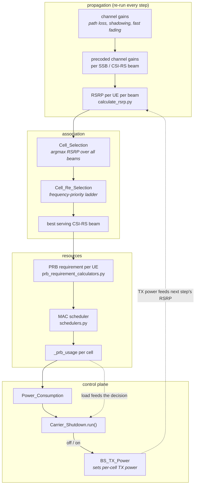

# Radio Resource Management (RRM)

**RRM** is everything that decides *which cell serves a UE, on which beam, with which
resources*. In Giulia it is not one class — it is a chain of stages that runs once per
simulation step, each one an event in the
[event-driven core](../../giulia/event_driven/eventDriven.py).

This page documents that chain end to end, because **carrier shutdown only makes sense
as a perturbation of it**. Switching a radio off is a one-line action; everything
interesting happens in how the rest of RRM reacts — UEs re-associate, the scheduler
reallocates PRBs, load moves onto the coverage layer, and the resulting PRB usage is the
very number the shutdown algorithm reads back on its next tick. That loop is the
feature.

- For the control-plane *plumbing* (the `RRC` class, the mailbox), see
  [The RRC layer](./rrc-layer.md).
- For the shutdown *decision*, see [Carrier shutdown](./carrier-shutdown.md).
- For how capacity cells are matched to coverage cells, see [Pairing](./pairing.md).

---

## 1. The RRM chain, in order

One simulation step runs these stages. All of them are scheduled at the same cadence —
`dflt_rescheduling_us = 1e6` µs, one second of simulated time
([`sim_config.py:717`](../../giulia/config/sim_config.py#L717)) — so they all fire at the
same timestamp and execute in **insertion order** (measured; see [§6](#6-ordering-within-a-step)).



The dashed arrows are the feedback loop. `BS_TX_Power` is not consumed again until the
**next** step's RSRP calculation, which is why a shutdown takes one step to show up in
the association and in the power KPI.

| # | Stage | Code | What it decides |
|---|---|---|---|
| 1 | RSRP per UE per beam | [`calculate_rsrp.py`](../../giulia/kpis/calculate_rsrp.py) | How strong each beam looks to each UE. Reads live TX power (§4). |
| 2 | Initial cell selection | [`Cell_Selection`](../../giulia/rrc/cell_selections.py#L23) | Best beam per UE by plain `argmax` of RSRP. |
| 3 | Cell re-selection | [`Cell_Re_Selection`](../../giulia/rrc/cell_re_selections.py#L123) | Overrides (2) using a frequency-priority ladder (§3). |
| 4 | Best serving CSI-RS beam | [`calculate_best_serving_beam.py`](../../giulia/mac/calculate_best_serving_beam.py) | Which data beam of the serving cell carries the UE. |
| 5 | PRB requirement | [`prb_requirement_calculators.py`](../../giulia/mac/prb_requirement_calculators.py) | How many PRBs each UE needs. |
| 6 | Scheduling | [`BaseScheduler._run`](../../giulia/mac/schedulers.py#L100) | Which PRBs each UE actually gets. |
| 7 | Load measurement | [`_prb_usage`](../../giulia/mac/schedulers.py#L133) | The `[0,1]` load figure the whole EE feature runs on (§5). |
| 8 | Power | [`Power_Consumption`](../../giulia/kpis/power_consumptions.py#L20) | Watts, from radio state + load. |
| 9 | Carrier shutdown | [`Carrier_Shutdown.run`](../../giulia/rrc/rrcs.py#L343) | Radio on/off for the **next** step. |

---

## 2. What lives in `giulia/rrc/`

The package name says RRC, but it holds most of the RRM configuration too. Only the
first two files are about energy efficiency.

| File | Responsibility | EE |
|---|---|---|
| [`rrcs.py`](../../giulia/rrc/rrcs.py) | `RRC` (per-cell control + inter-cell mailbox) and `Carrier_Shutdown` (the on/off state machine). | **yes** |
| [`cell_pairing.py`](../../giulia/rrc/cell_pairing.py) | `PairingCell` — which coverage cell backs each capacity cell. | **yes** |
| [`cell_selections.py`](../../giulia/rrc/cell_selections.py) | Initial association: strongest beam wins. | — |
| [`cell_re_selections.py`](../../giulia/rrc/cell_re_selections.py) | Priority-based re-association across frequency layers. | — |
| [`beam_configs.py`](../../giulia/rrc/beam_configs.py) | SSB / CSI-RS codebooks and the `beam_to_node_mapping` that the rest of the chain indexes by. | — |
| [`time_frequency_resources.py`](../../giulia/rrc/time_frequency_resources.py) | Carriers, PRB grid, OFDM numerology. | — |
| [`mcs_resources.py`](../../giulia/rrc/mcs_resources.py) | Modulation-and-coding-scheme tables. | — |
| [`tools_carrier.py`](../../giulia/rrc/tools_carrier.py) | Stateless 3GPP helpers: bandwidth → PRB count, symbol duration, control overhead. | — |

> The table is the whole package. `calculate_tx_power.py` used to sit here with a second,
> unused copy of the per-resource-element power split; it and its only importer,
> `bs/bs_deployments_old.py`, were removed. The live implementation is
> [`BS_TX_Power._uniform_split`](../../giulia/bs/bs_tx_powers.py#L235).

> `beam_configs.py` deserves attention even if you only care about EE.
> `beam_to_node_mapping` is a 1-D array of length *N_beams* giving the owning cell of
> each beam column, and **RSRP matrices are indexed by beam, not by cell**. Confusing the
> two is the cause of the pairing defect in
> [Pairing § 4.5](./pairing.md#45-the-majority-vote-model-and-its-beam-indexing-defect).

---

## 3. Association: two stages that disagree on purpose

### 3.1 Initial selection — strongest beam

[`Cell_Selection.strongest_rsrp`](../../giulia/rrc/cell_selections.py#L112) is one line
of intent: `np.argmax(rsrp_ue_to_cell_dBm, axis=-1)`. The winning beam is mapped to its
cell through `beam_to_node_mapping`. No thresholds, no hysteresis, no priorities.

`ues_per_cell` — the UE count that carrier shutdown uses to decide *which* cell to wake
first — is derived here, in
[`calculate_server_stats`](../../giulia/rrc/cell_selections.py#L139), as
`np.bincount(beam_to_node_mapping, weights=ues_per_beam)`.

### 3.2 Re-selection — the frequency-priority ladder

[`Cell_Re_Selection_Conf.process`](../../giulia/rrc/cell_re_selections.py#L59) assigns
each cell a re-selection priority equal to **the index of its carrier frequency in the
sorted set of frequencies**:

```python
for priority, dl_carrier_frequency_GHz in enumerate(sorted(set(dl_carrier_frequencies_GHz))):
    cell_reselection_priority[:, mask] = priority
```

[`priority_plus_strongest_rsrp`](../../giulia/rrc/cell_re_selections.py#L199) then walks
the priorities in **descending** order and takes the first layer where the strongest beam
clears `q_Rx_Lev_Min`.

This produces a pointed asymmetry worth stating plainly:

| Carrier | Re-selection priority | Preferred by re-selection | `cell_role` |
|---|---|---|---|
| 0.7 GHz (lowest) | 0 | **last** | `coverage` |
| 3.5 GHz | 1 | second | `capacity` |
| 26 GHz (highest) | 2 | **first** | `capacity` |

**Re-selection prefers the highest frequency a UE can receive — the exact inverse of the
order the role assignment uses.** That is deliberate and it is what makes the whole
scheme work: UEs are pushed up onto capacity layers whenever those layers are
receivable, and only fall back to coverage when they are not. A capacity cell is
therefore lightly loaded precisely when few UEs can hear it — which is exactly when it is
cheap to switch off.

`q_Rx_Lev_Min` defaults to `-200` dBm, tightening to `-108` for priority 1 and `-104` for
priority 2 ([`cell_re_selections.py:103-106`](../../giulia/rrc/cell_re_selections.py#L103)).
The diagonal is `None` → `NaN`, so a UE never re-selects to its own serving cell through
this path; the loop short-circuits first
([`cell_re_selections.py:266`](../../giulia/rrc/cell_re_selections.py#L266)).

---

## 4. What actually happens to UEs when a carrier is shut down

This is the question the energy-efficiency pages exist to answer, and it is worth
tracing precisely.

Shutdown does exactly one thing:
[`shutdown_singleBS_tx`](../../giulia/bs/bs_tx_powers.py#L149) writes `-inf` into
`BS_tx_power_dBm[cell_index]` and re-runs `process()`. Everything else is a consequence.

1. **`-inf` propagates cleanly.**
   [`_uniform_split`](../../giulia/bs/bs_tx_powers.py#L235) subtracts finite dB terms, so
   `BS_tx_power_SSB_RE_dBm` for that cell becomes `-inf`, **not** `NaN`.
2. **RSRP follows, live.** [`calculate_rsrp.py:90`](../../giulia/kpis/calculate_rsrp.py#L90)
   reads `getattr(bs_tx_power_obj, f"BS_tx_power_{beam_type}_RE_dBm")` on every call —
   there is no cached copy. The shut-down cell's RSRP column becomes `-inf`.
3. **Selection drops it.** `argmax` never returns an `-inf` column while any finite
   column exists.
4. **Re-selection drops it too.** The guard is
   `rsrp > q_Rx_Lev_Min` ([`cell_re_selections.py:287`](../../giulia/rrc/cell_re_selections.py#L287)),
   and `-inf > -200` is `False`. The UE keeps descending the priority ladder
   until it reaches the coverage layer.
5. **The scheduler empties.** With no UEs mapped to its beams, `ue_IDs_in_beam` is empty
   for every beam of the cell, so nothing is allocated and its `_prb_usage` falls to 0.
6. **The power model zeroes the transmit term.** `dBm_to_mW(-inf)` is exactly `0.0`,
   so `PRB_load × dBm_to_mW(power)` contributes nothing regardless of load.

So the migration is real and correct — UEs are not stranded. Two edge cases are worth
knowing:

> **If *every* cell is shut down**, `argmax` over an all-`-inf` row returns `0`,
> silently "associating" every UE to cell 0. Coverage cells never shut
> down under the shipped role assignment, so this is unreachable on the default path —
> but a custom role assignment, or a Dedalo run that forces every radio off, would hit it.
>
> **`set_BS_tx_power_dBm` and shutdown do not compose.**
> [`set_initial_singleBS_tx_power_dBm`](../../giulia/bs/bs_tx_powers.py#L160) restores from
> `initial_BS_tx_power_dBm`, which is snapshotted on the **first** `process()` call only
> ([`bs_tx_powers.py:79-80`](../../giulia/bs/bs_tx_powers.py#L79)). If an external caller
> changes a cell's TX power at run time (Dedalo does), a later shutdown→wake cycle
> reverts that cell to its *original* power, discarding the change.

---

## 5. `_prb_usage`: the one number the whole feature runs on

Every EE decision is a comparison against
[`BaseScheduler._prb_usage`](../../giulia/mac/schedulers.py#L133):

```python
prb_usage = self.resource_allocation['PRB_cell_activity'][:dl_PRBs_available][:, cell_idx].mean()
```

Four properties of it drive everything on the other EE pages:

1. **It is a fraction, not a rate.** It is the mean of a boolean occupancy column — the
   share of this cell's own PRBs that are busy. It says nothing about how much *traffic*
   that represents.
2. **It is not comparable across layers.** A 100 MHz capacity carrier and a 10 MHz
   coverage carrier at the same `_prb_usage` carry ~10× different traffic. The shutdown
   test adds two such numbers together as though they were commensurate — the direct
   cause of the limit cycle in
   [Carrier shutdown § 5](./carrier-shutdown.md#5-stability-there-is-no-hysteresis).
3. **It is a property, evaluated on read.** It is not a stored value; it reads
   `self.resource_allocation`, an attribute set only inside
   [`_update_resource_allocation`](../../giulia/mac/schedulers.py#L67). A scheduler whose
   `_run` has never completed a beam has no such attribute, and reading `_prb_usage`
   raises `AttributeError`. The preset avoids this by inserting the MAC events
   ([`g_standard_preset.py:1014`](../../giulia/presets/g_standard_preset.py#L1014)) before
   the RRC events ([`g_standard_preset.py:1122`](../../giulia/presets/g_standard_preset.py#L1122)),
   so the first `Carrier_Shutdown.run` always sees a populated allocation. **Preserve that
   relative order if you re-wire `configure()`.**
4. **It is exported.** [`BaseStations.prb_usage_per_cell`](../../giulia/bs/base_stations.py#L130)
   publishes the same quantity as a Saveable in the `cell_kpi` dataset, so an energy
   saving can be read against the load that produced it.

---

## 6. Ordering within a step

All RRM events share the 1e6 µs cadence, so ordering is decided entirely by
`EventDrivenSimulation`'s tie-break: column 2 of `pile_events_order` is an incrementing
counter, making same-timestamp events **FIFO by insertion**
([`eventDriven.py:123-125`](../../giulia/event_driven/eventDriven.py#L123)).

Measured firing order for the standard preset's insertion sequence:

```
channel / RSRP chain → best_serving_cell(SSB) → cell_reselection(SSB)
    → base_stations.process → MAC per cell
    → power_consumption → throughput
    → RRC carrier_shutdown per cell
```

Two consequences:

- **The power KPI leads the decision by one step.** `power_consumption` is inserted at
  [`g_standard_preset.py:1018`](../../giulia/presets/g_standard_preset.py#L1018), the RRC
  events at [line 1122](../../giulia/presets/g_standard_preset.py#L1122). A shutdown
  decided at step *k* is first reflected in `total_network_power_consumption_kW` at step
  *k+1*. When comparing an EE run against a baseline, align on that offset or you will
  attribute the saving to the wrong step.
- **A wake-up is delivered within the same step.**
  `add_event(0, …)` inserts at the current timestamp with a counter of `max+1`, so the
  woken cell's `run` executes after the coverage cell's, in the same step
  ([`rrcs.py:552`](../../giulia/rrc/rrcs.py#L552)).

---

## 7. Where the RRM stages are configured

| Concern | Set where | Notes |
|---|---|---|
| Cadence of every stage | `Simulation_Config.event_scheduling_info` ([`sim_config.py:724`](../../giulia/config/sim_config.py#L724)) | All default to `dflt_rescheduling_us`. Carrier shutdown reads `['base_stations_obj']['carrier_shutdown']`. |
| Scheduler model | `df_ep["BS_scheduling_model"]` → [`MAC._initialize_scheduler`](../../giulia/mac/macs.py#L67) | `random_per_cell_beam` or `simplex_based`; anything else raises. |
| Re-selection thresholds | [`Cell_Re_Selection_Conf.process`](../../giulia/rrc/cell_re_selections.py#L59) | Hardcoded; the code says "for simplicity we assume that all cells adopt the same configuration". |
| Roles and EE thresholds | [`set_dfEP_carrier_shutdown_attributes`](../../giulia/bs/bs_deployments.py#L454) | See [Carrier shutdown § 2](./carrier-shutdown.md#2-roles-and-thresholds). |
| Pairing graph | [`PairingCell.process`](../../giulia/rrc/cell_pairing.py#L88), in the preset's `__init__` | Runs once per `Giulia(...)` construction, not per episode. |

> **The re-selection tables are deliberately read through pandas, not numpy.**
> [`cell_re_selections.py:219`](../../giulia/rrc/cell_re_selections.py#L219) notes that
> `df_cell_reselection_priority` is re-read from the DataFrame on every call *"as these
> values may be modified over the top by an optimizer"*. That is the supported hook for
> changing association policy at run time — see [Dedalo](../dedalo/README.md).

---

## 8. If you are changing this layer

- **Adding an RRM stage:** insert its `add_event` in `configure()` at the position that
  reflects its data dependencies — ordering within a step is insertion order, not
  declaration order elsewhere. Anything that reads `_prb_usage` must come after the MAC
  events.
- **Changing association policy:** prefer writing into
  `Cell_Re_Selection_Conf.df_cell_reselection_priority` over editing the loop; the
  DataFrame is re-read every step by design.
- **Changing the load metric:** `_prb_usage` is read in three places —
  [`Carrier_Shutdown._get_mine_PRB_usage`](../../giulia/rrc/rrcs.py#L417),
  [`_get_pairedCell_PRB_activity_and_usage`](../../giulia/rrc/rrcs.py#L421) and
  [`Power_Consumption.calculate_power_consumption`](../../giulia/kpis/power_consumptions.py#L526).
  Making it comparable across layers (for example by weighting with
  `dl_PRBs_available`) would fix the stability problem described in
  [Carrier shutdown § 5](./carrier-shutdown.md#5-stability-there-is-no-hysteresis), but all
  three call sites and both thresholds would need to move together.
